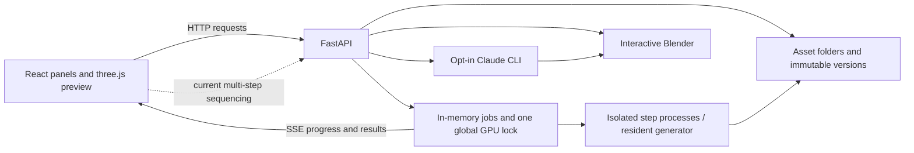

# Effigy UI redesign proposal

**Research date:** 2026-10-04 · **Code baseline:** `313595a` · **Status:** proposed, not implemented.

**Reader:** a coding agent implementing the interface. **Outcome:** a person can create, inspect, improve, find, and export an asset without understanding step names, version folders, or JSON parameters.

This is an implementation handoff grounded in the current code and rendered UI. Start with correctness, then deliver the guided workspace, then add library management. Keep React, TypeScript, plain CSS, and the imperative three.js viewer. There is no need for a UI framework, state library, router package, or engine rewrite.

## 1. Decisions at a glance

1. Give the app three clear destinations: **Library**, **New asset**, and **Setup**. Each asset opens a **Workspace**.
2. Organize the workspace around four understandable stages: **Reference → Generate → Prepare → Export**. Blender and texture editing are optional tools, not mandatory stages.
3. Give each stage one primary action, a large preview, a short explanation, and advanced options behind disclosure.
4. Automatically open the result of the user's action. Preserve manual browsing when a background job finishes.
5. Separate the selected history entry from the mesh being previewed and the input to the next operation. A validation report is not a mesh.
6. Group history into meaningful checkpoints while retaining every intermediate version and branch.
7. Treat imported models as a separate workflow. Do not quietly remove their materials through the generated-model preparation pipeline.
8. Make readiness, waiting, warnings, failure recovery, and downloads visible in the workspace. Raw logs are supporting detail.
9. Use a restrained charcoal studio aesthetic, warm ivory text, and a single amber action color. The asset supplies the visual interest.
10. Ship frontend improvements against existing endpoints first. Persistent library management and server-owned workflows require explicitly separate contract work.

## 2. What was examined and verified

Read the product workflow, architecture, implementation contracts, laptop handover, presets, frontend, viewer, jobs, library, models, Blender/Claude integration, and the relevant generation/preparation/validation/export steps. The findings below distinguish source inspection from runtime verification.

- `npm run build` in `ui/`: passed, including TypeScript checking and Vite bundling.
- `npx playwright test` in `ui/`: **2 passed** against the existing isolated temporary-library server on port 8123. Covered GLB viewing, channel switches, wireframe, an `_echo` job, version refresh, and Models & Licences rendering.
- Inspected the resulting `ui/test-results/smoke-pbr.png` and `models.png` at 1280 × 720. These are reproducible local audit artifacts, not committed design assets.
- Read-only inspection of the running app's asset API: **55 assets, 13 duplicate-name groups** at the time of inspection. This supports the existing library-rework request in the handover.
- The in-app browser connection was unavailable. Rendered evidence came from the repository's Playwright tests. No new GPU generation, model downloads, live Blender edits, or Claude runs were performed for this audit.

The existing smoke tests passing does **not** establish that the workflow problems below are fixed. Most are outside their coverage. README and older architectural prose describe ambitions or stale status; executable steps, current presets, and the handover's milestone table establish the current feature boundary.

### Current architecture and consequences for UX



| Layer | Current behavior | Design consequence |
|---|---|---|
| React app | Most components, selections, and sequencing live in `ui/src/main.tsx`; CSS is embedded in `ui/index.html` | Extract by screen/responsibility while implementing, rather than rebuilding the framework |
| Viewer | `Viewer.ts` loads a GLB, supports orbit, channel modes, wireframe, framing and an axis helper | Keep it; add lifecycle handling, load states and useful controls |
| API | Creates assets, uploads files, runs individual steps, serves version files, manages models and Blender actions | Most proposed guided controls can call existing endpoints |
| Jobs | Stored in `JOBS` in process memory; SSE has no replay or initial snapshot; public job responses omit asset and step | Refresh/reconnect cannot reconstruct all activity; frontend bookkeeping alone has limits |
| Sequencing | `App.chain()` submits one step and polls it before submitting the next | Reloading the tab stops future submissions; the already-submitted backend job can continue |
| Library | Immutable version folders with `parent`; listing returns asset records, detail returns versions | A branch is already supported; thumbnails and summary metadata are not supplied by the list endpoint |
| GPU | Ordinary step jobs share one lock; model downloads and Claude orchestration have different lifecycles | Explain waiting honestly; do not invent FIFO positions or combine all activity into a GPU percentage |
| Blender/Claude | Pull creates a version; Claude completion waits for accept/revert | Keep unsaved Blender edits and accepted library versions visibly distinct |

### What the new UI can actually offer

| Capability | Current implementation | UI scope |
|---|---|---|
| Text → concepts | Template brief; four candidates by default; scores and seeds saved | Guided description, category and candidate selection |
| Image → 3D | Upload → `prep` → `trellis2`; Faithful and Fast presets | Image review, background removal and generation |
| GLB import | Upload creates a root mesh version | Inspect, validate, export, Blender; optional geometry processing with disclosure |
| Production preparation | Clean → triangle remesh → UV → volume bake when available → validate | Guided settings and resumable checkpoints; no rigging promise |
| Texture replacement | `trellis2` with `op: "texture"`, UV mesh and prepared reference image | Optional image-conditioned texture tool; recorded as not yet manually verified in the handover |
| Export | Godot, Unreal, Unity, Web, OBJ, Print | Destination cards and actual generated files |
| Character pose normalization | `canon` exists; bake-off/in-progress in handover | Advanced experimental entry only until accepted; do not automatically run it |
| Multi-view generation | Vendored engine/model downloads exist; current generation step takes `image_rgb.png` | Do not show a working multi-view input flow |
| Rigging, animation, text-to-motion | Future milestones; no current runnable workflow | Exclude from the primary UI; category “Character” does not mean “rigged” |
| Image inpainting, “more like this”, progressive candidate previews | Described in proposals, not exposed as current completed flows | Do not render enabled controls or simulated results |

## 3. Findings to fix, in priority order

**P0 = wrong context or misleading/destructive derivative behavior. P1 = blocks an understandable workflow. P2 = improves polish and scale.** Source references are implementation pointers for this proposal, not claims that a new interface already exists.

| ID | Priority | Finding and evidence | Required result |
|---|---|---|---|
| F01 | P0 | `App.openAsset()` updates asset ID and versions without clearing/reconciling `version`. `ViewerPane` then combines the new asset ID with the old version. Numbered version names can coincide across assets. Requests also have no stale-response guard. | Keep an atomic asset/version selection; reject late fetch responses; never run or preview using another asset's metadata |
| F02 | P0 | `Next` offers the same “Make game-ready” flow for uploaded GLBs. `clean`, `remesh`, and `uv` write geometry-only derivatives; `canBake` skips bake when no ancestor has `ovoxel`. | Imported-model default preserves its original materials. Describe geometry-only output before processing; never present it as a completed textured asset |
| F03 | P0 | `BlenderPanel` finds the newest unresolved Claude run globally, although its comment says “on this asset.” Local `Job` has no asset ID. | Store/filter job context; show the correct asset and input version beside every accept/revert action |
| F04 | P1 | `chain()` returns the final version but callers generally never select it; `version_created` only reloads history. | Foreground action opens its result, with a “View result” notification if the user has navigated elsewhere |
| F05 | P1 | `Next` classifies every clean/remesh/UV/bake result as stage 2, then offers exports; it cannot guide completion of a partial production pass. | Determine the next useful operation from the current branch and outputs, not a stage index alone |
| F06 | P1 | `label(validate)` treats zero failures as “passed” even with warnings. `ViewerPane` has no report renderer and clears a checklist-only selection. | Render all checklist items beside the exact mesh they evaluated; distinguish warnings, failures, missing checks and unknown results |
| F07 | P1 | The backend publishes `gpu_load`; `App` handles it, but `events.ts` never subscribes to it. No SSE connection state is shown. | Add subscription; show unknown/reconnecting states rather than implying GPU idle |
| F08 | P1 | Jobs exist only in page state; `waitJob()` polls indefinitely without abort/recovery semantics; browser-side chains vanish on refresh. | Restore known jobs and preserve completed work; explicitly distinguish monitoring loss from computation failure |
| F09 | P1 | `Create` and `Candidates` have no submission lock. “Pick” may remove the background or also generate 3D depending on a separate select. Fields remain populated after creation; GLB upload is labeled “Create from image.” | Separate selection from execution, prevent duplicate submissions, use accurate input-specific labels and deliberate reset behavior |
| F10 | P1 | Candidate keys are sorted by filename, not score rank. Gate codes are shown raw; score fetch errors silently look like missing scores. | Rank visibly, explain failed checks, and show “Checks unavailable” when appropriate |
| F11 | P1 | Models page shows raw model tables and install-group buttons. `models.listing()` defines installed as “some files present,” not a verified complete installation. | Capability-led setup; never equate a nonzero folder size with a verified working generator |
| F12 | P1 | `Viewer.load()` can resolve out of order, errors are uncaught in the pane, and no disposal/unmount lifecycle exists. Channel switches allocate materials; `clear()` removes but does not dispose. | Latest selection wins; loading/error states; release owned GPU resources and event handlers |
| F13 | P1 | Asset/history items are clickable `<li>` elements; many inputs lack labels, images lack alt text, and controls are tiny. | Full keyboard workflow, persistent labels, visible focus, readable type and adequately sized controls |
| F14 | P2 | A fixed 300px sidebar holds creation, assets, all history, workflow, Blender and Claude. Models is an overlay while creation remains visible. | Distinct full-page destinations and a focused workspace with progressive disclosure |
| F15 | P2 | Flat asset names and detailed intermediate versions dominate navigation. No search/sort/thumbnails/management. Confirmed by live-library size and handover request. | Visual library, meaningful checkpoint history, and a separately implemented persistence contract for management |
| F16 | P2 | Export is six buttons plus raw filenames; `mainFile()` can use an export GLB, which may include collision helpers, as the ordinary preview. | Select destination, see its outputs/settings, then download; preview the source mesh unless explicitly inspecting the exported package |

## 4. Proposed information architecture and visual design

### Main destinations

| Destination | Purpose | Primary action |
|---|---|---|
| Library | Find and reopen assets; see recent results and active work | New asset |
| New asset | Choose description, image, or existing model; provide input | Generate concepts / Remove background / Import model |
| Asset workspace | Review the current checkpoint and advance it | Changes with stage and capability |
| Setup | Install the capabilities needed for the user's next task; manage Blender connection and attribution details | Install missing files / Check again |

Use existing hash navigation, with explicit parsing for `#/library`, `#/new`, `#/asset/<id>?version=<version>`, and `#/setup`. Preserve old `#models` as a redirect to Setup. Browser Back must restore location and selected version without replaying an operation. Unknown IDs get a useful not-found state and a Library link.

### Workspace wireframe — desktop, 1440 × 900

```text
┌──────────────────────────────────────────────────────────────────────────────┐
│ Effigy     Library / Brass lantern                 Activity 1   Setup  │
├──────────────────────────────────────────────────────────────────────────────┤
│ Brass lantern       v070 · Textured model          History     Edit in Blender│
│ Reference ✓ ───── Generate ✓ ───── Prepare ● ───── Export                      │
├────────────────────────────────────────────────┬─────────────────────────────┤
│                                                │ Prepare for your project    │
│ [Material ▾] [Wireframe] [Frame model]           │                             │
│                                                │ Triangle budget             │
│                                                │ [10,000                  ]  │
│              LARGE 3D PREVIEW                  │ Texture size  [2K ▾]        │
│                                                │ Height        [Keep size ▾] │
│                                                │                             │
│                                                │ Clean → simplify → unwrap   │
│                                                │ → bake → check              │
│                                                │                             │
│ [Reference thumbnail]                [Axes]     │ ▸ Advanced                  │
│ 9,842 triangles · 1 mesh                        │ [ Prepare model           ] │
├────────────────────────────────────────────────┴─────────────────────────────┤
│ Brass lantern · Baking textures · Step 4 of 5       [progress]  Cancel  Details│
└──────────────────────────────────────────────────────────────────────────────┘
```

The numbers above are illustrative. Show measured values from the selected asset in production. History opens a drawer; it is not a permanently competing third navigation column. The stage row navigates existing checkpoints or configuration screens; it never runs a step on click.

### Library and creation

```text
Library                                                [+ New asset]
[Search assets…                              ] [Newest created ▾]

┌──────────────────┐  ┌──────────────────┐  ┌──────────────────┐
│   asset preview  │  │   asset preview  │  │   source image   │
│                  │  │                  │  │                  │
├──────────────────┤  ├──────────────────┤  ├──────────────────┤
│ Brass lantern    │  │ Stone arch       │  │ Forest creature  │
│ Export available │  │ Needs review     │  │ Reference ready  │
│ Today · 14:32    │  │ Yesterday        │  │ Today · 10:08    │
└──────────────────┘  └──────────────────┘  └──────────────────┘

New asset
“What would you like to make?”
[ From a description ] [ From an image ] [ Import a 3D model ]
Only the selected mode's fields appear. One primary action follows them.
```

### Design tokens and layout rules

This is a local production tool: quiet surfaces, clear hierarchy, generous preview space, no decorative gradients behind the asset or continuous animations.

| Token | Proposed value / rule |
|---|---|
| Page / panel / raised surface | `#151719` / `#1E2226` / `#282D32` |
| Border | `#3B4249`; selected/interactive borders use a stronger visible color |
| Primary text / secondary text | `#F3F0E8` / `#ADB6BF` |
| Primary action | `#F2B66D` with `#191B1E` text |
| Success / warning / error | `#85C7A0` / `#E8BD70` / `#F28C85`, always paired with text/icon |
| Focus | 2px solid `#A9D4FF`, offset 3px; never clipped by panels |
| Type | Locally available `"Segoe UI Variable", "Segoe UI", sans-serif`; 15px body, 13px metadata, 20px section title, 28px page title |
| Spacing | 4, 8, 12, 16, 24, 32px; 24px panel padding on roomy screens |
| Controls | 40px standard height; 44px primary CTA; 8px corners; icons with visible labels where meaning is unclear |
| Workspace | 56px global header; flexible stage/title row; `minmax(0, 1fr) 336px` preview/action columns; 48px collapsed activity strip |
| Cards | At least 224px wide; square preview; 12px corners; no hover movement |
| Motion | 120–180ms opacity/color transitions; honor reduced motion; no auto-spinning models |

Use system-local fonts here to satisfy offline operation and the repository's minimal-dependency constraint. Do not fetch web fonts. These colors are design proposals: verify final text and control contrast before shipping.

Responsive rules:

- **≥1200px:** preview and 336px action panel side by side; history in a drawer.
- **900–1199px:** action panel 304px; wrap the title actions; library uses available card columns.
- **<900px:** preview above action panel; stage navigation remains accessible; history/activity open as sheets or normal document sections. Do not render an unusably narrow three-column layout.
- **390px and 200% zoom:** fields stack, buttons remain reachable, labels wrap, and the page scrolls naturally. The 3D canvas may pan internally; forms must not require horizontal scrolling.

## 5. User journeys and screen behavior

### A. Start from a description

1. New asset defaults to **From a description**. Show a large labeled prompt, optional name, and **Object / Character / Creature** choices mapped to existing category IDs. Example: “A worn brass lantern for a stylized adventure game.”
2. Show a short explanation of framing added by the category template. Keep the template-based brief automatic; do not add a mandatory editing screen for a YAML file.
3. **Generate 4 concepts** submits `brief`, then `concepts`. Disable repeat submission immediately. Keep entered values if a request fails. After success, navigate into the asset; clear the next creation form only after success or an explicit reset.
4. Show progress in the workspace. Current code exposes candidates through a completed version, not partial artifact events: show honest progress placeholders until completion, then the real grid. “Candidate 2 of 4” may use the reported progress text; a percentage is not an ETA.
5. Display a 2 × 2 grid sorted by `scores[filename].rank` ascending. Preserve the original `cand_<k>` key when sending `prep.params.pick`; display order is not the pick index.
6. Each card shows image, rank, meaningful check summary, and selection state. Clicking a card selects it without starting work. **Use this image** runs `prep` for the selected candidate and opens its result. **Generate 4 more** branches from the associated brief. **Edit description** creates a new brief version from the revised prompt/category, then concepts; it does not edit old artifacts.
7. In Reference, inspect the original and cut-out using a simple toggle. Then **Generate 3D**.

Translate gate names: `one_component` → “One main subject”; `margin` → “Subject stays inside the image”; `size` → “Subject fills the frame”; `resolution` → “Enough image detail”; `uniform_background` → “Simple background.” Explain the failing condition rather than dumping the key. Scores are heuristics: use “Reference checks passed,” not a guarantee of a good model. Flag hard-check failures prominently but permit an explicit “Use anyway” choice. If scores cannot load, say “Checks unavailable” and offer Retry.

### B. Start from an image

1. **From an image** shows a drop zone with a browse button; list PNG, JPEG and WebP. Keep a real accessible file input. Validate supported extension and image decoding, display filename/dimensions, and let users replace/remove the file.
2. **Remove background** creates the asset, uploads, and runs `prep`. Existing alpha can already bypass background removal in the step. Use an in-flight lock across all three requests.
3. Open the cut-out in Reference with checkerboard/neutral background toggle and original/cut-out switch. **Generate 3D** is the primary action; replacement remains available by uploading a new reference version to this asset.
4. Offer **Faithful — Recommended** and **Fast — Alternative model** as radio cards; expose engine names and actual preset parameters in Advanced. Default to Faithful, as the current presets require. “Fast” is a product preset name, not a promise: the [recorded reference-card benchmark](../bench/phase0.md) actually has a lower median for Faithful.
5. Advanced can expose seed and supported settings. Never offer Pixal3D a 512 pipeline it does not support. Use server presets as the parameter source.
6. A completed mesh opens automatically in Generate. Show **Prepare model**, plus secondary **Try another variation** and **Edit in Blender**. A variation uses the prepared-image ancestor as parent, not the mesh version.

### C. Import an existing model

1. **Import a 3D model** accepts GLB only. Do not advertise FBX/OBJ uploads; those are export formats here.
2. After upload, open the model immediately. Explain: “Imported model. Original materials are preserved in this version.”
3. Primary action: **Check model**. Secondary actions: Export and Edit in Blender. Reference/generation stages are “Skipped — imported model,” not completed generation claims.
4. Put **Simplify geometry** under optional tools. Before running it, state: “This creates an untextured geometry version. The original model stays in History.” The current clean/remesh/UV implementation does not preserve imported textures, skins or animation; route assets needing those preserved through Blender until a supported preservation path exists.
5. Do not call a missing-volume derivative fully prepared/textured. Re-baking from the generator's volume is unavailable. A UV-mapped imported mesh can use image-conditioned texture replacement if the user uploads/prepares a reference in the same asset, but that creates new textures rather than preserving its originals.

### D. Prepare a generated model

Show a short configurable recipe with friendly labels:

| UI field | Default | Existing call |
|---|---|---|
| Triangle budget | 10,000 | `remesh {faces: 10000}` and `validate {max_triangles: 10000}` |
| Texture size | 2K | `bake {texture_size: 2048}`; offer 1K/2K initially |
| Height | Keep current | `clean {}` or `clean {height_m: value}` when specified |
| Steps | Clean, simplify, unwrap, bake, check | Existing step names `clean`, `remesh`, `uv`, `bake`, `validate` |

Validate numerical input before submission: finite positive height when set, integer triangle budget within the step's 100–2,000,000 bounds, supported texture sizes. Advanced options may expose existing parameters, not invented settings.

**Prepare model** executes the chain on the chosen source. Each successful intermediate remains a checkpoint. Progress shows the current operation and “Step N of 5”; per-step progress must not be presented as a measured percentage of total time.

When it fails, show the last successful version, failed operation, plain-language error, Retry, and Details. Retry uses the last successful checkpoint as parent and re-runs only the failed operation plus the remaining recipe. Cancelling marks the recipe stopped before cancelling the current job, so a racing completion cannot start another step.

Opening an intermediate manually must offer **Continue preparation** with the appropriate remaining steps. Do not infer that reaching `clean` means preparation finished. A changed budget starts the necessary new derivative chain; it does not retroactively change old validation.

### E. Inspect, retexture, and edit in Blender

- Default viewport mode is **Material** (`pbr`). Put Base color, Surface normals, Ambient occlusion, Roughness, Metallic and UV checker in a labeled **Inspect** selector. “Surface normals” is accurate for `MeshNormalMaterial`; do not label it a raw normal-texture inspection.
- Keep Wireframe and Frame model readily available. Add front/side/top camera buttons through the existing viewer. Provide concise orbit/zoom help, loading status, and **Retry preview** on failure.
- Hide mesh-only tools for reference/candidate/setup screens. Keep readable mesh statistics near the bottom of the preview, not in the main action form.
- Use a small reference thumbnail to open a larger reference beside the mesh. Version comparison is a later enhancement: start with A/B switching in one renderer; synchronized dual viewports need explicit memory/performance verification.
- **Replace textures** is an optional tool: select a UV mesh and a prepared reference in this asset; run `trellis2` using the existing `retexture` preset and `image: <prep version>`. Preserve mesh topology/UVs per the step contract. Distinguish it from **Re-bake original textures**, which uses `ovoxel` lineage. Gate release on the existing M12 manual acceptance test.
- **Edit in Blender** opens a drawer with connection state and two clear actions: **Open selected model** and **Save Blender changes as version**. Pull captures the last-opened collection for that asset, which may differ from what the web viewer currently shows. Display the last known opened version; after reload, treat that context as unverified unless the backend supplies it.
- Put **Ask Claude** behind its own disclosure within the Blender tool. Show that it uses the configured online Claude service, identify the input asset/version, and show the activity summary. Preserve the existing account modes and backend checks without inventing a new login flow.
- Finished Claude work is **Ready for review**, not automatically saved. Before acceptance the app has no new result GLB to show: instruct users to review the live Blender view, then **Keep as new version** or **Restore snapshot**. An in-app before/after result preview requires a new capture contract; don't fake one.
- Prevent competing UI Blender edits while an unresolved Claude run owns the live editing context. Backend enforcement across tabs must accompany this in the job-contract slice. Cancelling Claude does not restore its snapshot automatically.

### F. Validate and export

Show the source mesh with a checklist panel. Load the file named by `outputs.checklist`; render every `items[name].status/value`. Use statuses **Passed / Warning / Failed / Not checked**. The current implementation checks manifold edges, watertightness, components, degenerate faces, UV existence/range, triangle budget, and a broad height sanity range. It does not establish correct rigging, animation, print wall thickness, or all production requirements.

Example header: **“6 checks passed · 2 warnings”**. Every warning includes its value and an action where one exists. Missing UVs can point to Unwrap; excess triangles to Simplify; topology problems to Clean or Blender. Never automatically “repair everything.” Missing/malformed checklist data is an unavailable report, not a pass.

Validation applies only to the exact mesh parent it evaluated and its recorded parameters. Any later geometry/texture edit requires a new check. Reports and exports should resolve their source mesh recursively through parents; exports must not make collision geometry the default working mesh.

Export layout: destination cards → applicable settings → **Export for <destination>** → success/download panel. Prioritize Godot and Unreal, as requested in the handover.

| Destination | Actual current outputs and behavior |
|---|---|
| Godot | GLB; optional convex collision helper; Godot handles LOD generation |
| Unreal | FBX; supported LOD group and named collision helper options |
| Unity | FBX and supported LOD group; do not promise automatic Unity collision setup |
| Web / AR | Meshopt GLB with WebP textures capped at 1024px, plus USDZ |
| OBJ | OBJ, MTL and exported base-color texture files |
| 3D print | STL and 3MF, converted to millimetres/Z-up; warn that wall thickness is not checked |

Offer LOD/collision toggles only for profiles that implement them. Preserve server defaults. Show which mesh version is being exported and its check summary. Keep **Export anyway** available as a deliberate choice for ordinary validation warnings/failures; show consequences and do not certify the asset as ready. The separate backend `restricted` guard must remain authoritative; never automatically set `allow_restricted`.

After export, show a primary download for the main file, companion files, and required `CREDITS.txt` / `LICENSES.json`. Read paths from the export's outputs. The current server has no bundle-download or open-folder endpoint: do not ship enabled “Download ZIP” or “Open folder” buttons until their backend support exists. Multi-file exports should state that their companion files are needed.

### G. Return to the library and history

Library cards show a real preview, name, meaningful state, creation time, and a short ID when names collide. Search and name/creation-date sorting work with the existing list API. Do not call it “Recently updated” until update times can be derived reliably or returned by the backend.

For the first slice, lazily fetch asset detail only for visible cards, limit concurrency, and cache by asset ID. Invalidate on new versions. Prefer a declared `thumb` or `preview`; otherwise find a reference image along the chosen branch. Never use a basecolor/ORM atlas as a rendered model thumbnail. Use a neutral “Preview unavailable” tile when no representative image exists. Adding generated thumbnails is separate work, not a reason to block the library.

History defaults to milestones: Reference, Generated model, Prepared model, Blender edit, Export. Fold clean/remesh/UV operations under the preparation checkpoint, with “Show intermediate steps.” Use actual parent links, not directory ordering, to represent branches. Show short version ID, source, time, key settings, restrictions, and “Continue from here.” Render cycle/missing-parent fallbacks rather than recursively crashing.

Archive, Rename, Keep/star, and source filters need persisted metadata and endpoints. The existing `provenance` values identify step/upload/Blender/Claude, not “bench / golden / mine.” Never guess origin from an asset name. Prefer archive over permanent delete in the first management release. If deletion is later added, reject active assets, explain scope, and preserve surviving references; it is not a frontend-only action.

### H. Setup, empty states, and recovery

Setup begins with capability cards: **Concept images**, **Faithful generation**, **Fast generation**, **Blender connection**. Fold raw model rows, experimental groups, file locations and licenses into details. A generation action missing known files links directly to the relevant capability card and preserves the user's draft.

With the existing API, use **Files found** / **Files missing** / **Downloading** / **Download failed**. Show “Files found; completeness not verified” where relevant. A true “Ready” badge requires a backend preflight/manifest check, including required shared files and runtime prerequisites. The healthy FastAPI endpoint is not proof the GPU/ML environment works. Distinguish disk GB from GPU-memory GB; don't show installed byte totals as remaining download sizes.

| Situation | Copy and action |
|---|---|
| Empty library | “Your next asset starts here.” → New asset |
| No search matches | “No assets match this search.” → Clear search |
| GPU step waiting | “Waiting for the current operation to finish.” → View activity / Cancel |
| Model loading | “Loading the generator…” → keep elapsed time and live activity visible |
| Out of memory | “This run ran out of GPU memory. Your previous version is safe.” → Retry with suggested settings |
| Connection lost | “Connection interrupted. The server may still be working.” → reconnect and reconcile; do not immediately retry the operation |
| Backend job no longer exists | “This session ended. Completed versions are still in your library.” → Refresh history / Continue explicitly |
| No cut-out subject | “Couldn't find a clear subject.” → Replace image / View details |
| Gated model download | Relevant existing access/login instructions, then Retry download; do not ask for a token in this UI |
| Blender disconnected | “Open Blender and start its add-on server.” → Check connection |
| Preview fails | “Couldn't display this version.” → Retry preview / History; preserve the file and job outcome |

Use contextual errors near the failed task and a compact persistent activity drawer. Do not put the entire stack trace in the header. Keep technical codes, logs, and raw parameters under Details.

## 6. State and implementation rules

### Selection and output ownership

Keep one selection record such as `{assetId, versionId}`. Resolve the version from that asset's current loaded detail, never from a second independent `Meta` state left over from another asset. Clear old detail/preview while loading a different asset, and use `AbortController` or a monotonically increasing request token to ignore late responses.

When opening an asset, use an explicitly requested valid version first, then a remembered valid selection, then the latest completed checkpoint. For result handling, capture the launching asset, input version and current navigation generation. Auto-select the final result only if the user still follows that foreground operation. Otherwise refresh that asset's cached history and expose **View result** without navigating away from the user's work.

Keep these concepts separate:

- **Selected entry:** what History highlights, possibly a report/export.
- **Preview source:** mesh or reference actually displayed, with its own asset/version/file URL.
- **Action input:** version whose outputs satisfy a specific step's prerequisites.
- **Validation source:** exact mesh version evaluated by a report, never merely “an ancestor somewhere.”

Use an explicit decision table for the action panel. Run context takes precedence over a selected version's step name; expose Inspect/Check/Export for an unfamiliar valid mesh instead of guessing that it completed a recipe.

| Selected checkpoint / context | Screen | Primary action |
|---|---|---|
| Brief | Reference | Generate concepts |
| Concept set | Reference | Use selected image |
| Uploaded image / canonicalized image without prepared RGB output | Reference | Remove background / Prepare reference |
| Prepared image with `image_rgb` output | Generate | Generate 3D |
| Generated mesh with usable volume lineage | Generate / Prepare | Prepare model |
| Imported mesh without volume lineage | Prepare | Check model; geometry-only processing is optional |
| Clean / remesh / UV inside a known preparation recipe | Prepare | Continue the recorded remaining recipe |
| Baked or retextured mesh, or a new Blender edit | Prepare | Check model; optional further edits depend on available artifacts |
| Validation report | Prepare / Export | Review issues, then choose export destination |
| Export package | Export | Download primary output and companion files |
| Running / failed recipe | Its current stage | Show progress and Cancel / Retry failed step |

An unfinished preparation history group is labeled “Preparation in progress,” not “Prepared model.” Export availability does not imply that checks passed. Store creation's returned asset ID before upload/preparation; if either fails, retry within that asset rather than creating another empty asset.

Illustrative helper for mesh tools; adapt to the final module organization and cover missing parents/cycles:

```ts
function resolveWorkingMesh(
  selectedId: string,
  versions: Meta[],
): Meta | undefined {
  const byId = new Map(versions.map(v => [v.version, v]));
  const seen = new Set<string>();
  let current = byId.get(selectedId);
  while (current && !seen.has(current.version)) {
    seen.add(current.version);
    // Export GLBs may contain collision helpers; work on their source mesh.
    const reportOrPackage = current.step === "validate" || current.step === "export";
    if (!reportOrPackage && Object.values(current.outputs).some(f => /\.glb$/i.test(f))) {
      return current;
    }
    current = current.parent ? byId.get(current.parent) : undefined;
  }
  return undefined;
}
```

This helper does not prove UVs, volume availability, material preservation, or valid preparation. Resolve those separately from actual artifacts/lineage. Keep existing report and package files accessible even when the mesh cannot be resolved.

### Jobs, progress, cancellation, and refresh

The immediate event fix is small:

```ts
const NAMES = [
  "progress", "log", "job", "version_created", "gpu", "gpu_load", "claude_event",
] as const;
```

Also publish connection status locally from EventSource `open`/`error`. On reconnect, fetch authoritative status for known active jobs and refresh affected assets; events can have been missed. Treat GPU readings as unknown until received and stale after connection loss. Keep a single EventSource for the page.

At submission, record `{jobId, assetId, inputVersion, step, params}` before later navigation can change the context. Merge early SSE events when the POST response arrives. Ignore unowned job actions unless context can be established. Clear progress on phase changes; use an indeterminate progress bar when progress is unknown, not a fabricated 0% or a stale previous-step value.

**Frontend-only recovery:** store known job IDs and recipe checkpoints in session storage, poll them on refresh, reconcile final versions, and offer **Continue preparation** explicitly. Prevent two page instances from resuming the same recipe automatically. If status fetch fails or returns 404, do not create another job speculatively. This cannot discover jobs from other clients or survive a backend restart as a complete job history.

**Reliable unattended chains:** move recipe execution to the backend in its own contract slice. The backend must own “next step,” stop the recipe atomically on cancellation, and persist enough state for reconciliation. Do not add infrastructure or a general workflow engine for this: a small named-recipe runner using existing jobs and version IDs is sufficient.

Keep HTTP error codes, not just messages, in `api.ts` so the UI can route `gated`, `oom`, `busy`, `restricted`, `missing_input`, and configuration failures to useful actions. For an OOM retry, show the setting changes and merge `error.suggest` into the original params. Do not retry paid Claude work or expensive generation automatically after an ambiguous network failure.

### Minimal module boundaries

Extract when the relevant screen is built; don't create unused scaffolding:

| Existing area | Proposed responsibility |
|---|---|
| `ui/src/main.tsx` | Bootstrap, app navigation and shared selection/activity ownership |
| `ui/src/api.ts` | Typed API responses and structured errors; keep raw upload semantics |
| `ui/src/events.ts` | Single event stream, connection status, typed event dispatch |
| New `ui/src/workflow.ts` | Pure lineage/capability/checkpoint resolution; recipe definitions for the frontend stage |
| New Library/NewAsset/Workspace screen components | Their actual layout and input state; don't split every small row into a file |
| New `ui/src/styles.css` | Tokens, layout and components, replacing inline stylesheet in index |
| `ui/src/viewer/Viewer.ts` | Renderer ownership, frame/reset, view modes, cancellation of stale loads and disposal |

When changing the viewer, dispose geometry/material/texture ownership correctly, including discarded late loads; avoid double disposal of shared textures. Disconnect ResizeObserver, remove pointer listeners, stop the animation loop, dispose controls/helper/PMREM resources and renderer on unmount. Bound pixel ratio for the laptop. Suspend hidden rendering where practical; a setup overlay should not keep an unnecessary model rendering continuously.

### Backend contract changes: explicitly separate work

These are **proposed**, not existing endpoints or fields. Follow `IMPLEMENTATION.md`'s separate contract-PR rule; update contracts, backend, callers and tests together. This document does not modify the frozen contract by itself.

| Slice | Minimum contract addition | Migration / fallback |
|---|---|---|
| Job discovery and ownership | `GET /api/jobs`; include `asset_id`, `step`, `parent`, params, timestamps and review state in public job records; consistent snapshot for active/finished jobs | Existing per-job endpoint stays; old records get defaults; don't pretend memory-only history survives restarts |
| Claude review recovery | Explicit review state `pending/accepted/reverted` and snapshot ID in job records; reject overlapping live-edit runs while review is pending | `done` alone is insufficient; reverting currently updates internal `RUNS.closed` without an authoritative review state in the response |
| Server-owned recipe | New run resource with recipe, asset, original input, step params, current job, completed step/version pairs and terminal status; create/status/cancel operations | Suggested routes: `POST /api/assets/{id}/runs`, `GET /api/runs/{id}`, `POST /api/runs/{id}/cancel`; exact schema belongs in contract PR. Use a client request key to deduplicate submission; record intent before executing. On restart mark ambiguous in-flight work interrupted and reconcile artifacts before an explicit resume |
| Library management | Asset rename/archive/source fields and version kept/star metadata; safe update endpoints; summary projection for thumbnails/states/update time | Defaults: not archived/not kept/unknown source; keep asset IDs and version paths immutable. Store review annotations separately from immutable generated outputs; document the chosen metadata schema |
| Readiness verification | A capability/preflight response distinguishing missing, partial, verified, unavailable and unknown | Keep current models listing for file sizes and details; readiness is not `installed === true` |

Archive must reject or explicitly coordinate with active runs; unarchive must be available. A ZIP export route is optional follow-up and must preserve all companion files and attribution. Avoid adding delete, a database, or generalized workflow infrastructure just to render the initial redesign.

## 7. Accessibility and interaction requirements

Use native buttons, inputs, selects, radios and disclosure elements where they fit. Asset cards can be links; candidate selection can be a radio group. Use actual labels, useful image alt text, `aria-current="step"` for the current stage, and `aria-pressed` for toggle buttons. No clickable `<li>` as the sole interaction.

Every action is keyboard reachable with visible focus. Dialogs/sheets must manage focus and return it to the trigger; Escape closes a transient panel without cancelling a job. Progress/completion uses a polite live status region; avoid announcing every log line. Failures that need immediate attention get a concise alert. The selected asset and model stats need readable text outside the canvas.

Target WCAG 2.2 AA: verify normal-text contrast at 4.5:1, relevant control boundaries at 3:1, keyboard access, visible/unobscured focus, and status announcements. The 40–44px design controls exceed the 24px minimum target-size criterion, subject to its exceptions. Reference: [W3C WCAG 2.2](https://www.w3.org/TR/WCAG22/) and [W3C target-size explanation](https://www.w3.org/WAI/WCAG22/Understanding/target-size-minimum.html). These are acceptance targets, not a conformance claim about the current app.

Keep primary actions visible in short windows without covering content. Don't rely on hover tooltips, color alone, or animation to explain readiness. Keep user prompts in a normal reading font; reserve monospace for technical details.

## 8. Ordered implementation slices

Each slice should be independently reviewable. Honor the repo's one-milestone-per-PR rule and reconcile the active milestone scope in `IMPLEMENTATION.md` before coding. This proposal is the requested sketch/handoff for the handover's library-rework item; it does not start an implementation or merge.

### Slice 1 — Correct context and honest results

**Touch:** frontend selection, API errors, events, `Next`, `BlenderPanel`, report rendering and viewer lifecycle; relevant UI tests. No API contract changes.

- Fix F01–F07, F09 and F12: selection reconciliation, result navigation, asset-scoped jobs, GPU events, submission guards, report/source resolution, imported-model disclosure and safe default.
- Keep the current layout temporarily so correctness is independently reviewable.
- **Done when:** A→B selection cannot mix metadata even with reversed response timing; an action opens the right result; a validation report retains its mesh and renders warnings; imported textured GLB offers Check/Export without silently processing away materials; Claude review never migrates to another asset; GPU activity reflects a synthetic event; repeated clicking makes one submission.

### Slice 2 — Guided workspace and visual system

**Touch:** UI screen components, stylesheet, workflow helpers, viewer controls and UI tests.

- Deliver Library/New asset/Workspace/Setup destinations and the proposed layout/tokens.
- Implement the three entry modes, reference/candidate review, Faithful default, guided Prepare, validation and destination-first Export.
- Add typed friendly forms, loading/empty/error states, responsive layouts and keyboard interactions.
- **Done when:** the description and image flows end in an export without raw JSON; imported models have the separate safe path; partial preparation can continue from the correct checkpoint; Back restores the selected version; the 1280 × 720 layout exposes the primary action without the present sidebar pile-up.

### Slice 3 — Library at realistic scale

**Touch:** Library and History UI; use current read endpoints first.

- Search, created-date/name sorting, duplicate disambiguation, lazy thumbnails, checkpoint grouping and branch selection.
- Show current-session activity with clear limits. Don't fabricate archived/source fields or failed-version folders.
- **Done when:** 100 assets with duplicate names and branched histories remain findable; browsing doesn't load 100 GLBs; missing thumbnails and parents don't break the screen; the precise branch/input is clear before a new operation.

### Slice 4 — Reliable activity and management contracts

**Touch:** `server/app.py`, jobs/library/Claude modules as needed, UI callers, backend/UI tests and frozen-contract documentation; split separate contract PRs where appropriate.

- Implement the selected job/review discovery contract, server-owned preparation recipe, library management metadata and true readiness checks.
- Add frontend recovery against those contracts. Persisting job/run records can use small files and the existing library architecture; no database is required by this proposal.
- **Done when:** refresh/reconnect restores activity and review state; cancellation between recipe steps submits no successor; restart is reported honestly; archive/rename survive reload; two tabs cannot both resume or accept the same work; ambiguous request retry cannot duplicate a recipe.

### Slice 5 — Optional power tools after the main path works

- Guided retexture after M12 acceptance; version A/B; richer generated thumbnails; bundled export downloads.
- Keep experimental character/multi-view/rigging work outside this UI redesign until its own implementation and acceptance exist.

## 9. Verification plan for the implementing agent

Use deterministic small fixtures and route mocks for long GPU outcomes, plus the real temporary-library backend smoke test. Route mocks validate UI behavior, not inference correctness. Retain the original smoke coverage when selectors change; prefer role/label selectors over structural `.list li` assumptions.

| Scenario | Required observable behavior |
|---|---|
| Fresh library / setup incomplete | Clear starting action; preserved draft when navigating to install instructions |
| Text flow | Brief → concepts → ranked selection → prep → model → preparation/check → actual export links |
| Image upload | File validation, replace/remove, cut-out review, explicit generation, correct loading/result states |
| Imported textured GLB | Original remains visible; Check/Export available; geometry-only transformation explicitly disclosed |
| Slow A / fast B asset response | B remains selected; neither preview nor next-step POST uses A's version metadata |
| Foreground completion / user navigated away | Auto-open only while following that operation; otherwise View result notification |
| Candidate ranking | Visually first candidate may be `cand_3`; prep still receives `pick: 3` |
| Mid-recipe failure/cancel | Last successful checkpoint retained; no unintended successor; retry resumes correct remaining steps |
| Checklist warnings/failures/unavailable | Accurate summary and items; source model retained; no false “passed” label |
| Fresh edit after validation | Old report marked inapplicable to the new mesh; re-check offered |
| SSE reconnect / page refresh / backend restart | Reconciles known state without duplicate jobs; unknown/interrupted states explained |
| Jobs on two assets | Activity and Claude review controls remain scoped to their asset/version |
| Unsupported capability | No enabled fake rigging, multi-view, progressive preview, folder-open or ZIP actions |
| Export profiles | Correct profile params and file links; companion files and credits retained; source preview excludes collision helpers |
| Viewer load A completes after B | B stays visible; rejected loads and unmounts release resources; failures allow retry |
| Many assets/history branches | Search/sort/duplicate labels work; lazy preview requests; no flattened incorrect ancestry |
| Keyboard and reduced motion | Entire task possible without pointer-only controls; sensible focus restoration and status announcements |

Capture and inspect Library, New asset, concepts, reference, mesh workspace, validation warnings, failed job, Export success, and Setup at **1440 × 900** and **1280 × 720**. Check forms at **390 × 844** and desktop **200% zoom**. Verify a long title, duplicate asset names, missing model files, and the disconnected state. Do not generate a separate full-page scrollbar inside every panel.

Run the relevant backend tests for any backend changes, the existing Python/ruff checks required by the repo, `npm run build`, and `npx playwright test`. Before declaring the real generation workflow accepted, run one actual image-to-export case on the reference GPU and one imported textured-GLB case; record timings and memory rather than borrowing benchmark claims. Blender/Claude acceptance requires its separate explicit live test; mocked events are insufficient.

### Handoff acceptance checklist

- [ ] Normal creation and export do not require a version-folder name, step name, or JSON editor.
- [ ] One primary next action is obvious for every supported checkpoint.
- [ ] Selection, preview, action input, and validation source always agree on asset and lineage.
- [ ] Imported model materials are preserved by default; limitations of optional processing are clear.
- [ ] Validation warnings/failures are rendered and never hidden behind a generic success label.
- [ ] Missing prerequisites, waiting, failures, cancellation, refresh, and reconnect have useful states.
- [ ] The asset library is usable with duplicates and at least 100 assets.
- [ ] Optional Blender/Claude and advanced controls do not crowd the default path.
- [ ] Every advertised action has a real implementation and accurate capability state.
- [ ] Visual, keyboard, responsive, and workflow checks above have recorded evidence.

## 10. Source map for a fresh coding agent

| Read first | Why |
|---|---|
| [CLAUDE.md](../../CLAUDE.md), [Ponytail skill](../../.claude/skills/ponytail/SKILL.md), [IMPLEMENTATION.md](../IMPLEMENTATION.md) | Minimal changes, fixed contracts, dependency/license constraints, milestone and verification rules |
| [WORKFLOW.md](../WORKFLOW.md), [ARCHITECTURE.md](../ARCHITECTURE.md), [HANDOVER.md](../HANDOVER.md) | Product intent, system boundaries, actual milestone status and existing library-rework request |
| [main.tsx](../../ui/src/main.tsx), [api.ts](../../ui/src/api.ts), [events.ts](../../ui/src/events.ts), [index.html](../../ui/index.html) | Current screens, sequence/state problems, network types and styling |
| [Viewer.ts](../../ui/src/viewer/Viewer.ts), [smoke.spec.ts](../../ui/tests/smoke.spec.ts) | Keep current viewport capabilities and smoke coverage |
| [app.py](../../server/app.py), [jobs.py](../../server/jobs.py), [library.py](../../server/library.py), [models.py](../../server/models.py) | Existing endpoints and limits; durable versions versus transient jobs; model file-presence semantics |
| [presets.py](../../server/presets.py), [concepts.py](../../steps/concepts.py), [prep.py](../../steps/prep.py), [trellis2.py](../../steps/trellis2.py) | Faithful default, candidate identity/scores, preparation input, generation/retexture parameters |
| [clean.py](../../steps/clean.py), [remesh.py](../../steps/remesh.py), [uv.py](../../steps/uv.py), [bake.py](../../steps/bake.py) | Geometry/material behavior and volume-lineage requirements |
| [validate.py](../../steps/validate.py), [export.py](../../steps/export.py) | Exact checklist statuses, real profiles/output files and restriction enforcement |
| [blender_client.py](../../server/blender_client.py), `claude_runner.py` (removed in M40) | Last-opened collection, snapshot, accept/revert and review-state ownership |

**Research handoff scope:** this document and its README index link are the deliverable. The UI/backend fixes above remain implementation work. Existing source/tests were examined and the current build/smoke baseline was verified; proposed behavior has not been implemented or certified by those checks.
