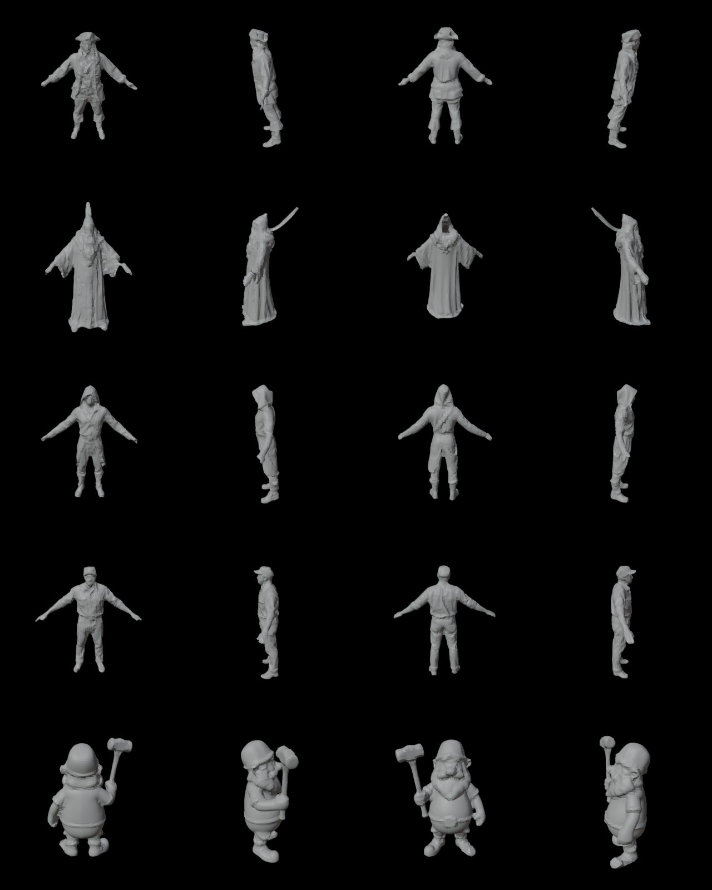

# M18 quad remesh: laptop acceptance (2026-10-04)

`remesh` with `topology: "quad"`, `faces: 8000` (the budget counts quads), symmetry off, on the raw
Faithful output (`trellis2` op `generate`, `hi.glb`) of 5 characters. RTX 5080 laptop, Blender 5.2.2.

| character | version | quads | triangles | non-manifold | voxels | Hausdorff | p95 | time |
|---|---|---|---|---|---|---|---|---|
| pirate (M16 A-pose) | `m16_flux_pirate/120_remesh` | 6464 | 0 | 0 | 100 | 3.87 % | 1.04 % | 4 s |
| mage (robe, staff) | `m16_flux_mage/110_remesh` | 6616 | 0 | 0 | 120 | 3.27 % | 0.73 % | 4 s |
| goblin | `m16_flux_goblin/110_remesh` | 5892 | 0 | 0 | 120 | 2.95 % | 0.72 % | 4 s |
| farmer | `m16_flux_farmer/100_remesh` | 6796 | 0 | 0 | 120 | 2.59 % | 0.44 % | 4 s |
| dwarf (hammer) | `a_dwarf_blacksmith_with_hammer_2/600_remesh` | 6632 | 0 | 0 | 120 | 9.33 % | 1.78 % | 4 s |

Distances: two-way, between 40k surface samples of the input and of the quad mesh, as % of the input's
bounding-box diagonal. The dwarf's 9.3 % is the hammer: the handle is a few voxels thick, so the closing
thickens it and fuses the hand to it. From `clean` instead of the raw mesh (the UI recipe): mage 6712 quads
p95 0.80 %, pirate 6556 quads p95 1.17 %, both 0 non-manifold.

## What it took

1. **QuadriFlow refused every TRELLIS mesh** ("needs to be manifold…") even after a clean voxel remesh:
   Blender's pre-check also rejects edges shorter than 1e-4 in absolute units, and a 1 m character has
   ~100. QuadriFlow now runs at 10× scale.
2. **Blender's voxel remesh hollows open input.** A raw Faithful mesh has ~12k open edges (small holes);
   OpenVDB then builds a thin sheet around the surface (mage: 1/90 of the volume), and QuadriFlow's quads,
   bigger than the sheet is thick, tore it into holes and inside-out patches. `steps/remesh.solid_hull`
   closes the solid first: surface voxels (160 along the longest side), dilate 1, fill what the outside
   can't reach, erode 1, voxel faces out as a closed mesh (0.7 s, numpy + scipy).
3. **QuadriFlow drops faces it can't make quads** (19–194 small holes, most of 3 edges). It now targets a
   quarter of the budget; the holes are filled, one Catmull-Clark level turns every face into quads, and a
   shrinkwrap onto the input brings the detail back.
4. **Symmetry did nothing**: `use_mesh_symmetry` mirrors the mesh's own symmetry axes, which were off.
   With X on, the result mirrors props too (the dwarf grew a second hammer: p95 6.1 %), so symmetry is
   opt-in for symmetric characters; the shrinkwrap keeps it approximate (farmer: 5.8 mm median mismatch).

Not done: the AutoRemesher CLI second candidate (QuadriFlow alone passes; add it when a character
fails); FBX export keeps triangles (glTF has no quads), `quads.obj` holds the quads.
