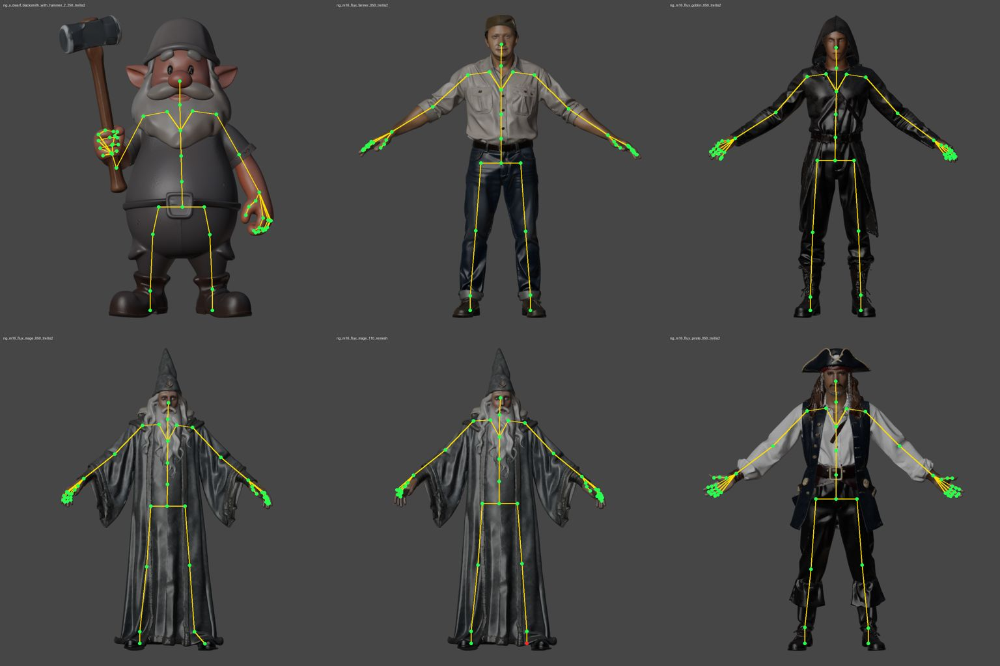

# M19 rig fit: laptop acceptance (2026-10-05)

`rig_fit` on the raw Faithful output (`trellis2` generate, `hi.glb`) of the 5 M18 bench characters, no
markers given (automatic fit). RTX 5080 laptop; DWPose on the CPU, Blender Workbench renders.

| character | version in | joints inside | facing | hands from keypoints | time |
|---|---|---|---|---|---|
| pirate | `m16_flux_pirate/050_trellis2` | 52/52 | +Z | both | 9 s |
| mage (robe) | `m16_flux_mage/050_trellis2` | 52/52 | +Z | both | 9 s |
| goblin (hood, cuffs) | `m16_flux_goblin/050_trellis2` | 52/52 | +Z | both | 9 s |
| farmer | `m16_flux_farmer/050_trellis2` | 52/52 | +Z | both | 9 s |
| dwarf (hammer, stylised) | `a_dwarf_blacksmith_with_hammer_2/250_trellis2` | 52/52 | **−Z** | both | 9 s |
| mage, quad remesh (untextured) | `m16_flux_mage/110_remesh` | 51/52 (LeftToeBase) | +Z | both | 4 s |

Through the app: `m16_flux_farmer/050_trellis2` → `110_rig_fit` (52/52, 10 s); both wrist markers moved
5 cm down → `120_rig_fit` (`source: edited`): the hands and their finger keypoints followed, every other
joint unchanged; 51/52 inside (a thumb, after that crude move).

## What it took

1. **The front isn't always +Z.** The dwarf faces −Z in the library; the front render showed its back and
   DWPose fitted a mirrored skeleton. Both sides are rendered; the one where the face scores higher
   (nose, eyes, ears) is the front.
2. **Untextured meshes** (clean, remesh): DWPose found no arms on the grey quad mage (37/52). Detection
   runs on the nearest textured version up the chain unless a step in between moved the frame (a clean
   that rescaled or recentred, a Blender or Claude edit); depths still come from the mesh itself (44 → 51).
3. **The inside test**: the winding number alone failed on raw meshes: a patch wound inward reads −1
   (the dwarf's hand), holes pull it towards 0 (the dwarf's forearm read 0.2 inside). Inside now means
   |winding| > 0.5 or inside a solid span along 2 of the 3 axes.
4. **Joints on a thin limb's edge** (keypoints sit on the silhouette): a joint outside snaps to the
   nearest span middle within 5 % of the height, along an axis from the joint or from the nearest vertex,
   that the inside test confirms (layered sleeve cuffs made some spans gaps between layers). Rays through
   a shared edge hit twice; duplicates are dropped.

Not done here: MHR/SOMA-X proportion priors (fixed fractions serve: all 5 pass; add when a body type
fails), a side render (front + mid-depth is enough on A-poses), the marker editor checked in the browser
by the owner (the Playwright smoke doesn't drive it yet).

## 2026-10-05: shoulders on armoured characters

The owner on `m16_flux_robot/430_rig_fit`: the shoulder markers didn't match the other markers. The
pose model put the robot's shoulders where its chest plate ends, ~5 cm inside the joints under the
shoulder pads, and the editor's default three-quarter camera foreshortened the near side, so the left
shoulder looked like the middle of the chest. `_rig.refine_shoulders`: along each shoulder's row the
front silhouette is followed outward to its edge, the joint sits half an upper arm's thickness inside
(only outward, at most half the upper arm). People barely move; the 7 fits stay 52/52 inside (the untextured quad mage 51/52, as before); the
robot's refit `440_rig_fit` has its shoulders at the chest's top corners under the pads. The marker
editor now switches to the Front view and labels the selected marker.
