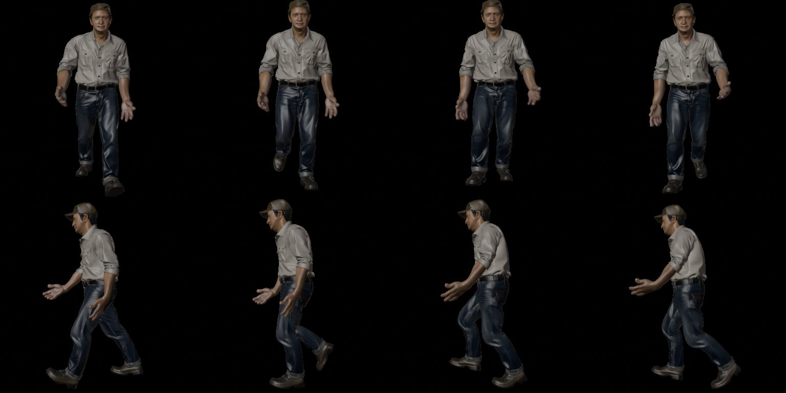
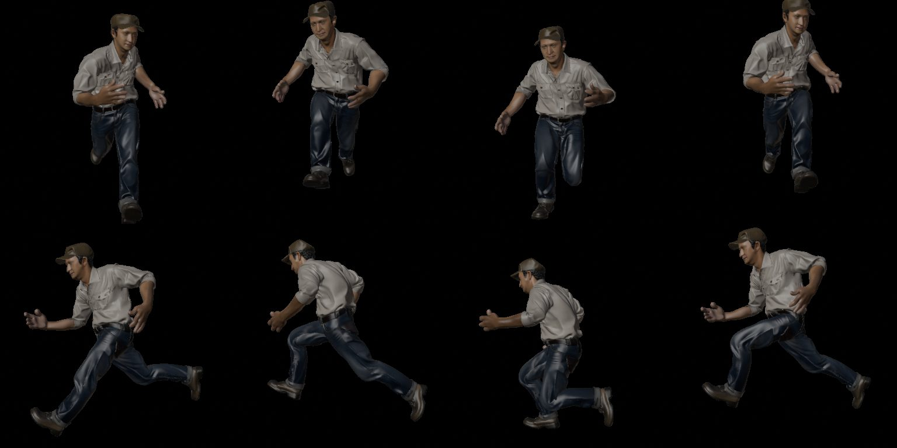

# M21 animation: laptop results (2026-10-05)

## Exports with a rig

`m16_flux_farmer/200_rig_skin` (Blender-engine skin, 52 joints) through `export`:

| profile | file | skeleton | clips (from `210_anim`) | checked |
|---|---|---|---|---|
| Unity | FBX | 1 armature, 52 `mixamorig:` bones, 4 LODs skinned to it, LOD group, nothing else | 4 takes `Armature\|Armature\|Idle_A` … | re-imported in Blender |
| Unreal | FBX | 1 armature, 52 UE5 Manny names (`pelvis`, `thigh_l`, `calf_l`, …), 4 LODs + `UCX_` hull | 4 takes | re-imported in Blender |
| Godot | GLB | 1 skin, 52 plain Mixamo names | 4 animations × 156 channels | imported headless in Godot 4.7.1: one `Skeleton3D`, 52 bones, the mesh skinned, `StaticBody3D` collision |

Before: each LOD file carried its own copy of the skeleton (4 armatures in one FBX) and the glTF importer's
bone display shape became an `Icosphere` mesh per LOD. Unity Humanoid import: the owner's manual check
(IMPLEMENTATION M21 acceptance), not done yet.

## Clips

**Bundled pack: Mesh2Motion human animations** (CC0, 178 clips in 3 GLBs, 12 MB, `tools/download_models.py
clips`, pinned to the app repo's commit `79f3f61` with SHA-256 per file; UE5 Manny bone names, 66 joints
incl. root and leaf tips, in-place except the `_RM` root-motion clips). Idle/walk/run: `Idle_A`, `Walk`,
`Jog` (also `Sprint`, `Run_Female`, …).

Other packs from the plan: **100STYLE** (CC-BY 4.0, Mixamo-named Geno skeleton, 74 joints, BVH): the
zips are 4.7 GB (BVH) / 3.5 GB (FBX), too large to bundle: an optional manual download later (its Geno
*mesh* is non-commercial and must never be used; the BVH carries no mesh). **Quaternius UAL** and
**KayKit** (CC0) sit behind Cloudflare/itch: manual downloads by the owner, not wired.

## Retargeting

`blender_ops/retarget.py`, our own transfer (research 05's fallback list), after the **Retarget
extension** (v5.2.0, GPL-3) fell short: the owner saw the arms wrong on every clip, then (after a
direction-only fix) the hands garbled and the Jog's shoulders wrapped backwards. Measured on the farmer
vs the pack skeleton: the rest poses differ in direction *and twist*. The pack is a T-pose, elbows
straight (2°), palms down; the farmer an A-pose, upper arms 48° lower, elbows bent 22–31° forward, palms
facing backward. The extension carried the direction offset into every frame; aligning directions alone
left the twist, 33° at the palms, in every frame.

What ships: per bone a *frame* from joint positions (no bone rolls: ours are arbitrary): the direction
head → main child, and a twist reference: the palm's normal from thumb, pinky and middle finger for the
hand, fingers and forearm (pronation lives there), the body's forward for everything else (up for the
feet, which run along forward). Our rest frame is turned onto the pack's, then, per frame in world
space, the source bone's rotation away from its own rest goes on top; hip travel scaled by the height
ratio (farmer 0.58); the pack is first turned about Z to face our way. Checked on the exported GLB
against the source, Walk and Jog, frames 0/8/16/24: every limb direction and both palm normals within
1° (the direction-only version: palms 33°/24° off; the extension: the arms 48° off).

The torso chain and the clavicles (`Hips`…`Head`, `Shoulder`s) skip the rest matching and take the
clip's *changes* only: the pack's clavicles run out and back from the chest front (+0.62 on the back
axis; ours straight out, 35–63° apart), its spine curves its own way (16° at Spine→Spine1), and
matching those directions pushed the farmer's shoulder joints back by up to 15 % of the torso height
and the head forward 13–16 %, in every clip ("shoulders bound backwards", owner, third report). Kept
as modelled, the shoulder joints and head move with the clip like the source's own (Spine2 within 1 %,
head within 5 % of the torso height, Walk and Jog); the limbs still match the source fully.

The pack's finger curl is **not** transferred by default: the farmer's open rest hand became a lumpy
fist (the voxel-proxy weights can't carry 15 finger bones over a generated hand); with the fingers at the
character's own pose the hand reads as a hand. `fingers: true` switches them on (Advanced → run any
step) for a character whose finger weights hold up.

Found on the way: the glTF importer leaves every clip's NLA track playing at once *and* an active action
on top (the last clip): both silenced before reading poses, and any check that selects a clip by muting
tracks alone measures the wrong clip (two of my diagnostics did). Blender 5 actions need a slot before
keys go in. ~1 s per clip (`Idle_A`+`Walk`+`Jog`+`Sprint` on the farmer in 5 s, 215k-vertex mesh).

`steps/anim.py` (light, Blender only): `rigged.glb` + clip names → `rigged_anim.glb` (one animation per
clip, same mesh and skeleton), `clips.json`. `GET /api/clips` lists the pack. UI: Animate is a stage in
the top bar; "Add animations" on a skinned model with the clip list (idle/walk/run ticked), the "Animated
model" panel, the viewer's Animation menu (three.js AnimationMixer, loops). Per-clip GLBs
(IMPLEMENTATION M21): not written, one GLB with all clips serves the viewer and the engines (the FBX
takes and the Godot animations come from it).

## Open

- Unity Humanoid import check (owner, manual; deferred by the owner on 2026-10-05, "skip any unity checks
  for now"): the farmer's newest `anim` version → Export for Unity → drag into Unity, set the FBX's Rig to
  Humanoid, play `Walk`.
- The upper arm's twist rests on "the front of the arm faces forward in both rests" (true for an
  A-pose and a T-pose; a character modelled with the arms turned out would show it at the shoulder);
  a root bone for Unreal (`root` above `pelvis`), which the Manny retargeter likes; root-motion clips
  (`_RM`) keep their hip travel scaled like the rest.
