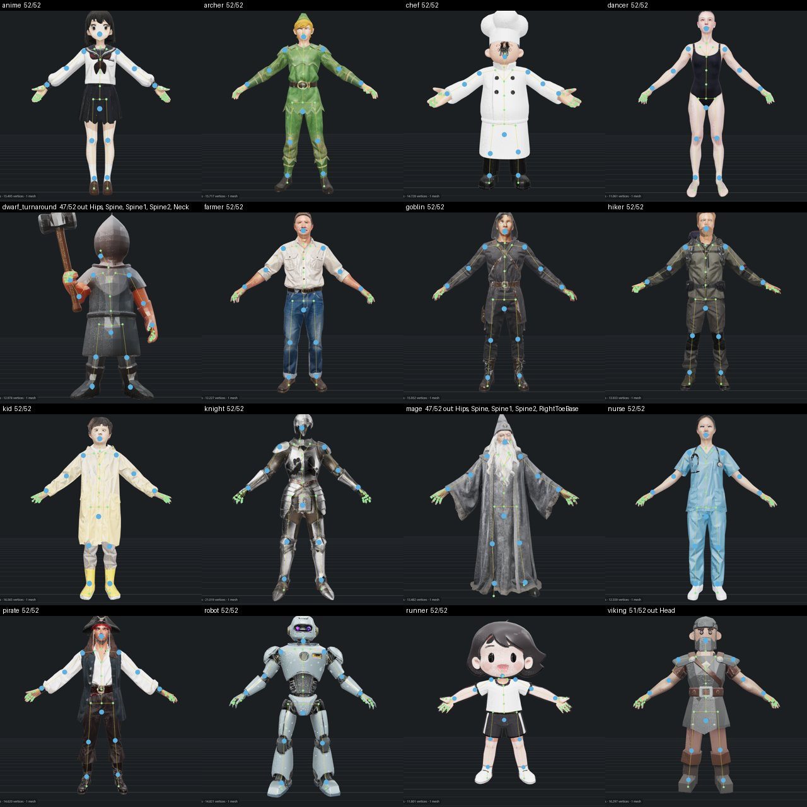

# M22 Phase-2 exit bench: characters

**Status: run on 2026-10-06 (laptop, the owner's terminal, 101 min): 16 characters, 12 need no marker
fix (75 %), acceptance met.** One skinning-engine failure (the chef: bone heat found no solution on its
proxy) was fixed the same day and the chef re-run passes; with it 13 of 16 (81 %). The set turned out to be
16, not 15: the ten M16 posed characters, nurse, hiker, anime, viking, kid, and the dwarf turnaround.

## Procedure

1. Once: the M17 turnaround sheet into the set (it lives only in the laptop's library), look at it, commit it:
   `copy library\m17_dwarf_turnaround\010_upload\image.png tests\fixtures\characters\dwarf_turnaround.png`
   (2048 × 512, front | right | back | left; the order is `dwarf_turnaround.views.json`).
2. Laptop plugged in, max power profile, Blender closed (RAM: Faithful holds 24 GB), start the app (`run.bat`).
3. `.\.venv\Scripts\python.exe -m tools.bench --preset game-character --set tests\fixtures\characters --out docs\bench\m22.csv`
4. Paste the printed summary below, fill the table, look at every character that needs a fix (which
   joints, which QA check) and write the result into IMPLEMENTATION M22 "As built" and HANDOVER.

Chain `game-character` (`server/presets.py` `CHAINS`): upload → prep → canon (FLUX.2-klein A-pose +
DWPose gate) → prep → trellis2 Faithful (1024_cascade, 12 steps) → clean → remesh 15k tris → uv → bake 2K
→ rig_fit → rig_skin (`auto`) → anim (Idle_A, Walk, Jog); checks validate (budget 15k) + export (Godot
GLB). The turnaround skips prep, canon, prep for prep op `views` (a re-pose of one view would break the
others), so generate runs on all four views.

CSV: as `phase0.md`, plus `canon_pose` (the gate on the re-posed image), `canon_seed`, `trellis2_seed`
(rerun one character with the same seeds), `rig_fit_inside` / `rig_fit_joints` / `rig_fit_hands_detected`,
`rig_skin_engine` / `rig_skin_fail`, `anim_clips`. A step that runs twice gets a numbered tag (`prep2`).

## Acceptance

- [x] 16 inputs: the 10 M16 posed characters, nurse, hiker, anime, viking, kid, the dwarf turnaround
- [x] ≥ 70 % need no marker fix: **12 of 16 (75 %)** in the run, 13 of 16 with the chef re-run. Counted by the bench summary: the chain succeeded and
      every joint is inside the mesh (`rig_fit`). Skin QA fails are recorded (`rig_skin_fail`), not
      counted: a held prop or a robe fails it whatever the markers (`m20.md`; owner, 2026-10-05).

## Results

**Accepted by the owner on 2026-10-06**, together with M22b (the skeleton editor), after their own edits on the viking.

`docs/bench/m22.csv`, run 2026-10-06 08:00–09:40, app started fresh, Blender closed. Bench summary:
`15/16 succeeded`, `no marker fix needed: 12/16 (every joint inside the mesh)`.

| character | ok | canon pose | joints inside | skin engine, fails | clips | faces | total |
|---|---|---|---|---|---|---|---|
| anime | ✅ | a | 52/52 | blender, 0 | Idle_A, Walk, Jog | 15241 | `190_anim` |
| archer | ✅ | a | 52/52 | blender, 0 | Idle_A, Walk, Jog | 14438 | `190_anim` |
| chef | ❌ rig_skin | a | 52/52 | – | – | – | `160_anim` |
| dancer | ✅ | a | 52/52 | blender, 0 | Idle_A, Walk, Jog | 14986 | `190_anim` |
| dwarf_turnaround | ✅ | – | 47/52 (Hips, Spine, Spine1, Spine2, Neck out) | skintokens, 1 | Idle_A, Walk, Jog | 14816 | `260_anim` |
| farmer | ✅ | a | 52/52 | blender, 0 | Idle_A, Walk, Jog | 14248 | `190_anim` |
| goblin | ✅ | a | 52/52 | blender, 0 | Idle_A, Walk, Jog | 15188 | `190_anim` |
| hiker | ✅ | a | 52/52 | blender, 0 | Idle_A, Walk, Jog | 14364 | `190_anim` |
| kid | ✅ | a | 52/52 | skintokens, 0 | Idle_A, Walk, Jog | 14868 | `250_anim` |
| knight | ✅ | a | 52/52 | blender, 0 | Idle_A, Walk, Jog | 15736 | `190_anim` |
| mage | ✅ | a | 47/52 (Hips, Spine, Spine1, Spine2, RightToeBase out) | skintokens, 1 | Idle_A, Walk, Jog | 15026 | `220_anim` |
| nurse | ✅ | a | 52/52 | blender, 0 | Idle_A, Walk, Jog | 14874 | `190_anim` |
| pirate | ✅ | a | 52/52 | blender, 0 | Idle_A, Walk, Jog | 14320 | `190_anim` |
| robot | ✅ | unsure | 52/52 | blender, 0 | Idle_A, Walk, Jog | 14645 | `200_anim` |
| runner | ✅ | other | 52/52 | blender, 0 | Idle_A, Walk, Jog | 14066 | `250_anim` |
| viking | ✅ | a | 51/52 (Head out) | blender, 0 | Idle_A, Walk, Jog | 15401 | `230_anim` |

- **Generate** (Faithful 1024 cascade, 12 steps): median 91 s, max 118 s (the four-view dwarf); whole-GPU
  peak 12.75 GB single view, 14.21 GB multi-view. The chef took 132 s for the same step the day before:
  the NAF attention rework of `docs/archive/CODE_REVIEW_2026-10-05.md` landed in between.
- **Per character** median 5.4 min; the whole run 101 min. The nurse's 22 min are one `canon` of 1069 s
  (median 56 s): its log stops at "Loading pipeline components… 0 %" and shows no stack dump; the
  re-pose itself then ran normally. Once in 15 loads; left as an observation beside the once-hung
  Faithful run in HANDOVER.
- **Re-pose gate** (`canon_pose`): 13 `a`, the robot `unsure`, the runner `other` (the M16 blind spot:
  both fits came out 52/52), the turnaround skips canon.
- **Rig fit**: 52/52 joints inside on 12; the three others are the torso chain or the head: dwarf
  (Hips, Spine, Spine1, Spine2, Neck), mage (Hips…Spine2 and a toe: the robe), viking (Head: the
  helmet). In the viewer the joints look right on all three; the inside test reads a hollow or
  double-shelled torso as outside. They count as "needs a marker fix" by the bench's rule; nobody moved
  a marker in this run.
- **Skinning**: `auto` picked Blender on 12, SkinTokens on 3 (dwarf, kid, mage); 0 fails on 13, 1 fail
  on the dwarf (hammer) and the mage (robe), as in `m20.md`. Median 58 s with both engines run.
- **Animation**: Idle_A, Walk, Jog on every character that got there; Godot export and validate passed
  on all 15.

### The chef: bone heat found no solution

`rig_skin` failed on the chef with `rig_qa: need a skinned mesh and an armature, got EMPTY …`. The
Blender engine's export had `JOINTS_0`/`WEIGHTS_0` but no `skins` entry: on the chef's 120-voxel proxy
Blender's bone heat failed for every bone (`Bone Heat Weighting: failed to find solution`), every vertex
stayed without a group, the nearest-vertex fill had nothing to fill from, and the glTF exporter drops a
skin whose mesh has no weighted vertex. The same total failure `m20.md` saw at 200 voxels on 4 of 6
characters. Fix (`blender_ops/skin_proxy.py`): bone heat is retried at 90, 60 and 40 voxels until a
solution appears (`report.proxy_voxels` says which), and fails loudly otherwise; `rig_skin` in `auto`
now keeps the engine that worked when the other fails (a Blender failure used to fail the step with a
SkinTokens result in hand). The chef re-run through the app after the fix: the proxy at 90 voxels, skin
QA 0 fails (warn: L/R 0.18, stretch 3.2×), Blender picked over SkinTokens, `110_rig_skin` → `120_anim`
(Idle_A, Walk, Jog) → validate and Godot export ok, 60 s. The CSV keeps the run as it happened.

### The dwarf: which way does it face (owner-reported, twice)

The owner played the dwarf's clips: arms and legs rotated wrongly, feet off the ground; after a first fix
(sides swapped) "completely broken": at rest the dwarf faces the camera, the clip plays with the limbs
turned the other way. Cause, one step earlier than the retarget: `rig_fit` decides the facing by the pose
model's face scores on a front and a back render, and on the helmeted dwarf both were a coin flip (0.34
front, 0.47 back); it chose −Z for a character that faces +Z (the turnaround puts the front at +Z by
construction), placed the toes backwards and ran the detection on the back render. The retarget then
turned every clip around. The runner (a flat cartoon face, 0.30 / 0.48) had the same wrong call, with no
visible harm only because its labels and the hip line still agreed on +Z.

Rule now (`rig_fit._detect`, calibrated on all 16 plus the two older meshes): the face decides when its
best score is ≥ 0.5 (0.60–0.92 on the 14 readable faces); otherwise the feet decide (`_rig.feet_cue`:
how far the feet reach ahead of the shins, +0.012…+0.051 of the height on the bench, −0.024 on the
M19 dwarf that really faces −Z) when they reach at all (≥ 0.01); otherwise +Z. `metrics.facing_by` says
which. The render the joints are read from is a separate choice: the face's when it was read, else the
one the pose model sees a body in (`detected_view`; on the dwarf's frontal render it saw almost nobody,
body score 0.38, and scrambled the arm chains across the body; on its back render it saw a body, 0.69).
The render's own camera maps its pixels; the facing places toes and fingers. On top, `rig_fit` swaps the
sides when the labels contradict the facing (`sides_swapped`), and the retarget takes the body's forward
from the toes instead of from the side names, so a label slip can never turn a clip around. Re-runs
through the app: dwarf `190_rig_fit` (facing +1 by the feet, read from the back render, 47/52 inside, arm
chains on their own sides) → `200_rig_skin` → `210_anim`; runner `180_rig_fit` (facing +1 by default,
52/52) → `190_rig_skin` → `200_anim`; both play facing the camera they stand in. The chin marker on the
dwarf sits off (the helmet): a marker fix.

### Three more for the owner's eye: viking, kid, mage (2026-10-06)

Fit → skin → animate re-run with the current code on three different risk profiles; the owner looked at
the clips.

- **Viking (helmet, low-poly): hands turned palm-up.** The retarget's palm normal came from the pose
  model's finger keypoints (thumb, pinky, middle), and those are swapped or scattered on about half the
  bench characters (the normal's up-component had the wrong sign on one hand of 9 of 16). Fix: the hand's
  frame is read off the mesh itself in `retarget.hand_shapes`: the vertices beyond the wrist within a
  hand's reach of the forearm's axis; their longest axis is the hand's direction, their thinnest the palm
  normal, signed by a rest-pose prior (a palm faces down, toward the body or backward, never up or
  outward). The pack's reliable finger joints keep the formula, signed alike. Viking `180_anim`: hands
  hang palm-in.
- **Kid (child proportions, rubber boots): toes up, feet off the ground.** The pose model marked the
  ankle mid-boot, 61 % along the foot, so the foot bone stood almost on end (75° below horizontal) and the
  retarget turned the toes up to match the pack's forward-tilted foot. Fix in `rig_fit`: the ankle snaps
  to 30 % of the measured heel-to-tip extent (40° after). Kid `180_rig_fit` → `190_rig_skin` → `200_anim`:
  the boots stand flat.
- **Mage (robe): the bench's `120_anim` looks better than the re-run `170_anim`.** Same mesh, same
  skeleton (0.0 mm difference), different SkinTokens weights: 15 % of the vertices differ by more than
  0.05, the pose-volume check 9.7 % → 30.8 %. Two back-to-back runs with the same seed differ the same way
  (12.7 % of vertices): SkinTokens is not deterministic on this GPU despite the seeds (`m20.md` believed
  it was, from the farmer alone). The robe is the known hard case on both engines; `120` stays the
  owner's version. Open below.

### Full re-run of fit, skin and animation on all 16 (2026-10-06, afternoon)

Every bench asset from its bake version through `rig_fit` -> `rig_skin` -> `anim` with the code as of
`f00689e` (facing rule, side check, ankle snap, mesh-based hand frames, toe-based forward, bone-heat
retry). All 16 chains succeeded, about 1 min each. The owner checked the clips: the animations work,
with small exceptions to look at next.

| asset | fit | skin (engine, fails) | animated version |
|---|---|---|---|
| anime | 52/52 | blender, 0 | `170_anim` |
| archer | 52/52 | blender, 0 | `170_anim` |
| chef_2 | 52/52 | blender, 0 | `190_anim` |
| dancer | 52/52 | blender, 0 | `170_anim` |
| dwarf_turnaround | 47/52, facing by feet | skintokens, 1 | `240_anim` |
| farmer | 52/52 | blender, 0 | `170_anim` |
| goblin | 52/52 | blender, 0 | `170_anim` |
| hiker | 52/52 | blender, 0 | `170_anim` |
| kid | 52/52 | skintokens, 0 | `230_anim` |
| knight | 52/52 | blender, 0 | `170_anim` |
| mage | 46/52 | blender, 2 | `200_anim` |
| nurse | 52/52 | skintokens, 0 | `170_anim` |
| pirate | 52/52 | blender, 0 | `170_anim` |
| robot | 52/52 | blender, 0 | `180_anim` |
| runner | 52/52, facing by default | blender, 0 | `230_anim` |
| viking | 51/52 | blender, 0 | `210_anim` |

The mage's engine pick flipped to Blender this time (SkinTokens variance); the robe fails its QA on both.

The owner's exceptions after this run: the runner's arms rotated, the hiker's fingers cut off, the
farmer's wrists off. The first and third were the mesh-based palm normal of the morning (its prior
"never forward" was wrong for the runner's forward-facing palms, and its hand direction from the mesh
moved the farmer's wrists). Rule now (`retarget.palm_normals`, third form after the owner found one
of the viking's hands wrong again: its finger normal was 85° off the hand's shape without pointing up):
the pose model's finger normal when its axis agrees with the hand's shape (within 35° of the mesh's
thinnest axis) and does not turn the palm up; else the mesh axis, signed down or toward the body, or by
the fingers' sign when the palm is horizontal; the hand's direction stays joint-based. On the 16: the
fingers serve 23 of 32 hands, the mesh 9. Re-animated from the same skins: the
versions in the table above (runner `240_anim` palm to the thigh, farmer `180_anim` wrist natural,
viking `220_anim` kept palm-in). The hiker's hand: the fingers are short pointed stubs in the generated mesh itself (checked at rest, both
hands: the photo-real hiker lost its poles to the re-pose and the hands came out as blobs); nothing in the
rig or the retarget cuts them. A hands-and-heads geometry item, with the faces.

## Open

- ~~The torso-chain "outside" reads on the dwarf and the mage~~: fixed 2026-10-06 after the owner saw
  the viking's Spine and Head flagged while visibly in place. Those meshes are double shells; the
  spine sits in the cavity, where no solid span is, and the vertical ray leaves through the neck hole, so
  "enclosed on all three axes" failed. Enclosed on two axes counts now (`_rig.inside`); over the 16
  bench skeletons that clears exactly the dwarf's and the mage's torso chains and the viking's spine
  and head and keeps the kid's ring finger and the mage's toes. In the viewer the flagged joints are
  drawn red (M22b).
- The `canon` load stall (nurse, once).
- SkinTokens' run-to-run variance (the mage): `torch.use_deterministic_algorithms` with the cuBLAS
  workspace setting, or run it twice and keep the better QA; unmeasured which.
- The owner's two requests from looking at the run (2026-10-06): ~~a better way to fine-tune markers in
  3D~~ (M22b: joints and markers with a gizmo, accepted the same day), and faces that
  look like the generated image (the bake from the 1024 volume and 2K atlas loses the face; the input
  image is pixel-aligned with the mesh, so projecting it onto the head is the fix: PLAN Phase 3
  "projection refine", pulled forward). Both unscheduled; the owner sets the order.
- Unity Humanoid import: deferred by the owner (`m21.md`).
