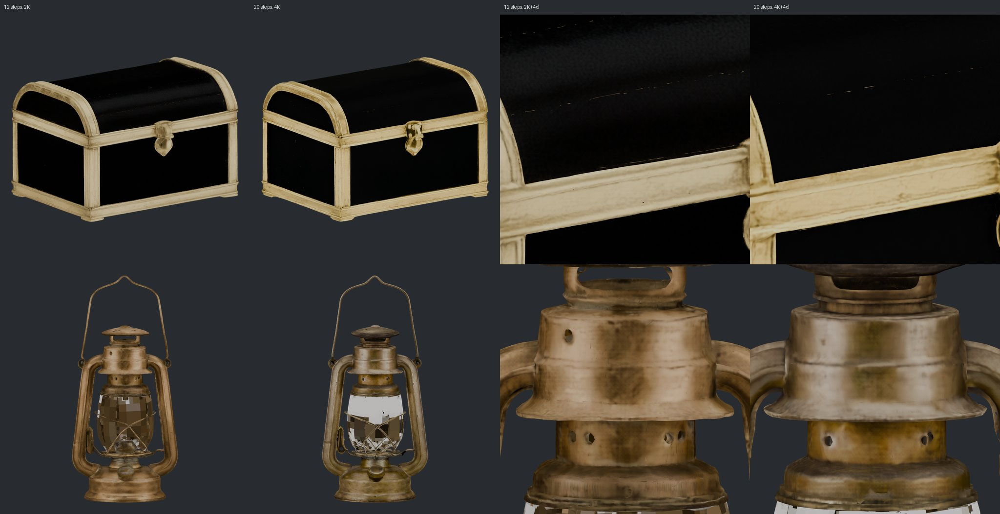

# M46 bench: the 16 GB laptop through `tools/gpu_report.py` (research 16 §5.1)

RTX 5080 Laptop (15.92 GB, sm_120), driver 617.42, Windows 11, torch 2.8.0+cu128, 31.4 GB RAM. Budget 14.6 GB (M45).
2026-10-13. The app running in the owner's terminal, nothing else on the GPU. The probes are the tool's own: the
golden barrel, seed 7, each probe an ordinary job through the app's pre-flight and cap. "GPU peak" is the whole card
from nvidia-smi every 0.5 s (desktop included, 0.15–0.7 GB before a job). "torch" is the step's own
`max_memory_allocated`. The report is `m46_laptop.json`.

| Probe | Settings | Result | s | GPU peak GB | torch GB |
|---|---|---|---|---|---|
| prep | – | done | 14.0 | 2.45 | – |
| fast | 1024_cascade, 12 steps, 2K (cold, with the load) | done | 169.5 | 9.72 | 6.39 |
| clean / remesh / uv | 10k faces | done | 11.8 / 4.5 / 2.8 | 2.90 / 0.87 / 0.86 | – |
| bake | 2K | done | 23.4 | 4.73 | – |
| refine | lite Tile | done | 182.4 | 13.20 | 9.81 (12.81 reserved) |
| faithful | 1024_cascade, 12 steps, 2K (cold) | done | 133.2 | 11.73 | 9.20 |
| **faithful-20-4k** | 1024_cascade, **20 steps, 4K** (warm) | **done** | 148.7 | **11.86** | **9.20** |
| canon | FLUX.2 klein with CPU offload (cold) | done | 55.0 | 9.82 | 9.17 |
| motion | Kimodo, the encoder on the CPU (cold) | done | 65.8 | 1.54 | – |
| **fast-1536** | **1536_cascade**, 12 steps, 2K, in the app's worker | **failed**: the worker ended without a word ("no RESULT") | 533.4 | **15.42** | – |
| fast-1536, again | the same as a one-shot step (`-X faulthandler`, budget 14.62, the app's environment) | done | 655.4 (493 sampling) | **15.52** | 12.62 |
| faithful-1536 | – | not run: Fast at 1536 already reached the card's edge | – | – | – |

## What it shows

- **20 steps and 4K textures fit 16 GB.**
  - The peak is unchanged: 11.86 against 11.73 for the whole card, and 9.20 for torch in both.
  - Sampling takes 128 s against 100 s, so the whole step is about 25 % longer.
  - The research 09 figure of "≈ 17 GB for 16 steps / 4K" was the wrapper without `low_vram`.
  - On the barrel's 512 px previews the 20-step model has a cleaner lid rim (the 12-step lid shows a seam ridge).
    Otherwise the two look alike. The 4K texture needs a close-up to judge (M46b).
- **1536 does not belong on a 16 GB card.**
  - **The card**: Fast at 1536 samples within the cap (torch 12.62 GB), but the whole card reached 15.52 of
    15.92 GB.
  - **The RAM**: host RAM fell to about 2 GB available while the 23.2 M-face mesh was simplified to 200k (1024 makes
    10.8 M).
  - **The two runs**: in the app's resident worker the process ended without an error line or a Windows crash
    record. As a one-shot step it finished in 11 minutes. Sampling took 493 s, about 3.5× Fast's 1024, as TRELLIS.2's H100
    times predict, and the simplify and bake about 150 s.
  - **Its need**: `tools/gpu_report.NEED` makes ≥ 15.1 GB (a lower bound) Fast-1536's need, so a 16 GB card skips
    it. M46b moves that into `VRAM_GB`, keyed on the pipeline type, and adds a `RAM_GB` row (est. ≥ 28 GB of host
    RAM: the worker's ~18 GB plus the 1536 mesh).
- **The silent end is a safeguard gap.** The step protocol had no word for "the process just stopped". A resident
  worker's death now says `the trellis2 worker exited <code> without ERROR`, with Windows' crash codes in hex
  (0xc0000005, an access violation), so the next one can be told apart: an exit code 3 is usually a C++ abort, a hex
  code a native crash. Native prints already reach `jobs.log` (`steps/_common.py` sends fd 1 to stderr), and this one
  printed nothing.
- **Canon and motion as measured before** (m16: 9.23 GB; m26: about 1 GB on the GPU). Both are M46a's subjects: canon
  without the offload, and Kimodo's encoder on the GPU (~17 GB, so 24 GB cards only).
- **Canon without the offload** (M46a, 2026-10-13: one-shot `steps.canon`, the viking's cut-out, seed 7; the whole
  card polled from `nvidia-smi`; capped at **12.5 GB**, below the ~13 GB this laptop is kept under):

  | canon | result | s | whole card GB | torch GB |
  |---|---|---|---|---|
  | `offload: true` (as before) | done, pose a | 47.0 (load 9.8, edit 21.5) | 9.78 | 9.17 |
  | `offload: false` | out of memory while loading, 15.7 s | – | 12.69 | – |

  - **The weights alone are 14.9 GB**: text encoder 7.49, transformer 7.22, VAE 0.16. With ~2 GB at work (the offloaded
    peak minus the transformer) the whole pipeline needs **about 17 GB**: 24 GB cards and up (`canon.GPU_GB`, est.).
  - Research 16's "~13 GB" was a claim; on 16 GB the offload stays.

## M46b: Faithful at 12 steps + 2K (the old default) against `faithful-hq` (20 steps + 4K, the new one)

2026-10-13, through the app on the laptop, seed 1, two golden pictures; front views and 4× close-ups of `hi.glb`,
Workbench with flat light, so the texture shows as it is (`m46b_2k_vs_4k.jpg`).

| picture | settings | s | torch GB |
|---|---|---|---|
| chest | 12 steps, 2K (cold) | 126.7 | 9.2 |
| chest | 20 steps, 4K | **stalled**: 25+ min in xatlas `pack_charts` (one CPU core), cancelled | – |
| chest | 20 steps, 2K | 140 | 9.2 |
| chest | 20 steps, 4K (again, same seed) | 150 | 9.2 |
| lantern | 12 steps, 2K (cold) | 88.4 | 9.2 |
| lantern | 20 steps, 4K (warm) | 71.2 | 9.2 |

- **What 4K buys:** whole views look the same. At 4× the 4K edges are crisper and the streaks finer: the chest's trim,
  the lantern's rims. The game chains bake again at 2K from the volume, so the gain is for the generated model itself,
  close-ups and prints. The lantern's 20-step sample came out a cooler brass. The glass is blocky in both: transparency
  is a separate problem.
- **Same memory:** torch 9.2 GB in every run, as in m46's first measurement.
- **The stall** did not repeat with the same settings (150 s).
  - xatlas packs the charts on the CPU, and the texture size does not reach it (`_simplify_unwrap` passes no pack
    options). So it can hit any preset.
  - Cancel ended it cleanly.
  - A follow-up if it comes back: a time limit or a chart cap for the packing.

