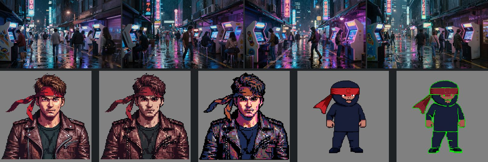

# M50 Pictures: `concepts` op `image` on the laptop (2026-10-12)

RTX 5080 Laptop 16 GB, Z-Image-Turbo fp8 storage (as `run`), 9 steps, `PYTORCH_CUDA_ALLOC_CONF=backend:cudaMallocAsync`
as `server/jobs.py` runs steps. One process, as the resident worker runs it (`bench_m50.py` in the session's
scratchpad: `concepts.run` in a loop, `torch.cuda.mem_get_info` sampled every 0.2 s for the card's own peak).

| Run | Size | Seconds | torch peak | reserved | on the card |
|---|---|---|---|---|---|
| one wallpaper, cold (the 26 s load included) | 1920 × 1088 | 59.7 | 8.29 GB | 9.38 GB | 10.62 GB |
| four wallpapers, warm | 1920 × 1088 | 116.7 (29 s each) | 8.29 GB | 10.19 GB | 11.44 GB |
| the same before the tiled decode | 1920 × 1088 | 116.2 | 10.70 GB | **15.26 GB** | – |
| a portrait, style `pixel`, cut-out | 1024 × 1024 | 60.3 | 8.44 GB | 9.66 GB | 10.91 GB |
| a plain picture after the style | 1024 × 1024 | 15.6 | 8.29 GB | 9.41 GB | 10.66 GB |
| `run` (a 3D concept) after the style | 1024 × 1024 | 15.4 | 8.29 GB | 9.41 GB | 10.66 GB |

- **The VAE decodes in tiles above 1024 px** (`vae.enable_tiling()` for the job, off after it): in one piece the
  1920 × 1088 decode reserved 15.3 GB of the 16, past the ~13 GB this laptop stays under. At 1024 px and below the
  tile size is the picture, so `run` and square pictures are unchanged. `VRAM_GB["concepts"]` = 8.5 (torch's
  peak, as the 8.4 of M10 was).
- **Styles**: diffusers loads a LoRA through `peft` (added to the `ml` group, Apache-2.0). peft gives an adapter its
  base layer's dtype, here the fp8 storage, and no matmul takes fp8 (`addmm_cuda not implemented for
  Float8_e4m3fn`). Its own rule for quantised layers, a `compute_dtype` attribute on the layer, keeps the adapter
  in bf16: `_pipeline` sets it on every fp8-stored Linear. Each job loads its style, unloads it in a `finally`,
  and the next plain job and `run` come out as before (the last two rows).
- **End to end over the real API** (a test server from the branch, an empty library): `create_asset(kind="2d")`,
  `brief` (category `item`), `concepts` op `image` (two pictures, style `pixel`, cut-out; 66 s cold), `pixelize`
  (`key: image_1`), a recolour (`palette: "input"`, the darkest colour to green): every version where it should
  be, the licences down the chain (Z-Image, BiRefNet, the pixel LoRA).

## Pixelize's grid detector on real pixel-style pictures (M51's open question)

`_pixel.grid`'s period and autocorrelation peak per axis (`MIN_PEAK` 0.3):

| Picture | x | y | Found |
|---|---|---|---|
| pixel-style portrait (head and shoulders) | 8, 0.80 | 8, 0.75 | 8 |
| pixel-style full body, picture 1 | 6, 0.11 | 7, 0.36 | 7 |
| pixel-style full body, picture 2 | 7, 0.19 | 6, 0.05 | none: scale 1, a 1024 px result |
| four plain wallpapers | 18–30, ≤ 0.10 | 27–32, ≤ 0.14 | none |
| a plain barrel, a 3D concept | 24, 0.04 | 28, 0.08 | none |

The style's "pixels" are regular on a close-up and drift on a full figure. A threshold of 0.15 for periods up to 16
would take picture 2 and still leave every plain picture out, but three pixel-style samples are too few to move a
knob on, so it stays. Instead the UI starts a picture that was not made with the pixel style at a height (360 px for
a wide one, 64 for a subject), and a result with no grid says so and points at a height. Retro-Diffusion's
`pixel-art-fixer` or `pixeldetector` (both MIT) remain the fallback research 15 named if misses pile up.
