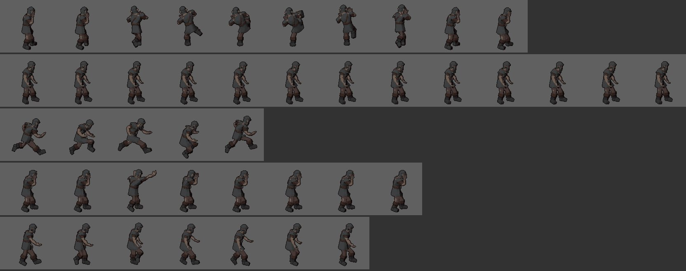
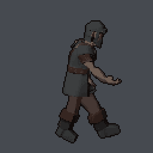
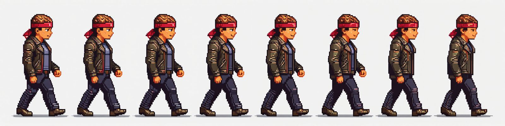

# M52 Sprites from the 3D character on the laptop (2026-10-12): the brawler-hero proof

The bench viking (`bench_faithful_viking`, its skinned version and ancestors copied into a scratch library, a test
server from the branch): two Kimodo motions from text, the pack's Idle, Walk and Jog, all five onto the rig, sprites,
pixel art. Over the real API, one job at a time:

| Step | Seconds | Result |
|---|---|---|
| `motion` "A person throws a fast straight punch with the right fist, then returns to a fighting stance." (2 s) | 69 (the Kimodo load) | `201_motion` |
| `motion` "A person does a roundhouse kick with the right leg, then returns to a fighting stance." (2.5 s) | 6 (resident) | `202_motion` |
| `anim` Idle_A, Walk, Jog + the two motions | 4 | `203_anim` |
| `sprites` 104 px, yaw 90, pitch 12, 12 fps, studio light | 3.5 for 126 frames (28 ms a frame) | 128 px cells |
| `pixelize` scale 1, 15 colours, outline the darkest | 6 | 15 + transparent |

- **In place, no drift**: the camera follows the root's straight line from a clip's first frame to its last, so a
  walk's stride is gone and its sway stays. Per clip, the figure's mean x over the frames and its lowest pixel row:
  Idle 70.1–70.7 / 121–122, Walk 70.8–72.8 / 116–120, Jog 72.2–75.2 / 106–121 (the airborne frames), the punch
  70.9–75.5 / 120, the kick 69.3–76.8 / 110–121 (the leg up). The ground under the root is one row for every clip.
- **No anti-aliasing**: Workbench with `render_aa = "OFF"` and a transparent film gives a binary alpha straight from
  Blender (`tests/test_sprites.py` checks it), about 1 400 colours a frame before pixelize.
- **Light**: Workbench studio light keeps the form and reads dark on generated textures; flat (unlit) is bright but
  flattens the shape (a nurse's legs merge). Studio light at +0.5 stops was the best of 0, +0.5 and +1 on the viking,
  the nurse and the archer and is the default; `shading: "flat"` stays at 0.
- **One scale per asset**: `camera.json` keeps the pixels-per-metre; a later run without `height_px` reuses it, so
  a clip rendered next week matches today's sheet (`test_sprites.py`).
- Not done: `toon` shading, the Freestyle outline (pixelize's 1 px outline at the final size does it better), the
  ground shadow and the normal maps (research 15 §5.4's optional rows); 4 or 8 directions work through `yaws`.

## The picture generator as a sprite-sheet maker (the owner's question, 2026-10-12)

Asked of `concepts` op `image` with the pixel style, 2048 × 512, two seeds: "pixel art sprite sheet of one street
brawler … walk cycle, eight frames in a single row, side view facing right, the same character in every frame, evenly
spaced, plain flat background" (67 s, 7.7 GB):

- **Identity holds within one picture** (better than research 15 §4.4 expected): the same face, headband, jacket
  and boots eight times.
- **It is not an animation**: the eight figures stand in nearly the same stride, not the contact-pass-contact steps
  of a cycle; the second seed drew seven figures, unevenly spaced, the trousers changing colour mid-row. A punch or
  a kick would have to be asked as poses one by one, and a 120-frame hero as many separate pictures, where identity
  no longer holds.
- **Where it fits**: a set of still variants in one style (pickups, icons, a breakable's states, VFX keyframes), or a
  character design picture that then goes through the 3D chain (picture → model → rig → animation → sprites), as
  this milestone does. Slicing such a set into frames would be a small `pixelize` option (find the figures between
  the background gaps), not built.

## The Double Dragon set (2026-10-12, with M53)

New asset's animation picker has **Move set** choices (`workflow.MOVE_SETS`): *Brawler (Double Dragon)* (20 of the
pack's clips: fighting idle, walk, jog, both jabs, cross, hook, front kick, jump start / air / land, two hits, the
knockback, getting up, a death, block, pick up, throw, victory), *Sword fighter (Golden Axe)* (19: the sword idle,
regular attacks A-C and the combo, an air attack, block, a spell, the same jumps, hits, falls and victory) and
*Basic*. The text source has **Fighting moves** presets for what the pack lacks (roundhouse, flying kick, uppercut,
grab and knee, throw, back elbow), each a 2.5 s sentence.

On the viking (scratch library, the test server): the brawler set + the Kimodo roundhouse from above → `anim` 7 s →
`sprites` 382 frames in 7 s (the cell grew to 176 px for the falls) → `pixelize` 15 colours + outline 21 s → the
check passes → `godot-2d`; Godot 4.7.1 loads all 21 animations at 12 fps.

**Which moves play once**: the pose rule alone (the last pose against the first) left the pack's jabs, cross,
kick and hits looping, since the pack authors them to end in their start pose; a brawler's code waits for an
attack's `animation_finished`, which a loop never sends. `steps/sprites.ONCE` adds the names (attacks, hits, falls,
a jump's start and landing, throws): Godot then reads 15 of the 21 as one-shots and loops idle, walk, jog, block,
the jump's air phase and victory.
