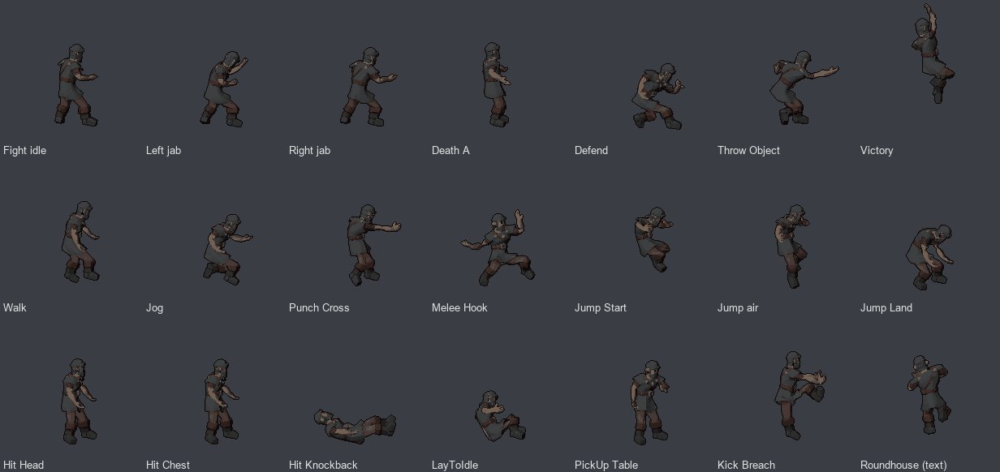

# How to animate a pixel-art character

A walking, punching, kicking pixel-art hero for a side-scroller (a Golden Axe or Double Dragon kind of game),
ready for Godot. Effigy does it the way a sprite artist with a 3D tool would: the character becomes a 3D model, the
model gets a skeleton and its moves, and every move is drawn back from the side as pixel art. One model, one
palette and one camera keep the character the same in every frame.



<sub>The bench viking with the *Brawler (Double Dragon)* move set and a roundhouse kick made from a sentence: 21
moves, 382 frames of 15 colours, picture to Godot in under a minute of computing ([bench](../bench/m52.md)).</sub>

## Before you start

Install these in **Setup** (each card says what it needs and how big it is):

| Card | For |
|---|---|
| Concept images | the character's picture from a description |
| 2D styles | the pixel-art look of that picture (optional: any picture works) |
| 3D model, Faithful | the 3D model made from the picture |
| Standing pose | redrawing the picture as a shaded 3D figure, standing, before its model is made |
| Character skeleton | fitting the skeleton |
| Learned skinning | attaching the mesh to the bones (optional: Blender's bone heat works without it) |
| Ready-made animations | the move sets (178 clips, CC0) |
| Text to motion | moves the pack does not have, from a sentence (optional; needs a Hugging Face login) |

Blender comes with the app. Already have a picture of your character? **New asset → A 2D picture
or sprite → From an image**, and start at step 3.

## 1. Make the character's picture

1. **New asset → A 2D picture or sprite → From a description.**
2. Describe the character, for example *a female viking with an axe, for a side-scroller like Golden Axe*.
3. **Kind: Item or sprite** (one figure, cut out). **Style: Pixel art** if you want the pixel look already in the
   picture. Leave *Cut out the subject* ticked.
4. **Make 4 pictures** (about a minute). Pick the one you like in the strip under the view.

The 3D model is made from this picture, so it decides how well the character animates: a full figure, standing,
arms a little away from the body, both legs visible (add *standing, arms slightly out* to the description). An axe
raised over the head or crossed arms make the skeleton harder to fit; hold the weapon low.

Starting in 3D instead gives the pose the skeleton fits best: **New asset → A 3D model → From a description →
Kind: Character** makes four concept pictures in an A-pose; pick one, **Remove background**, and go on at step 4.

## 2. Try the pixel-art look (optional)

On the pictures: **Make it pixel art**. *The grid the picture was drawn on* works for pixel-style pictures; if the
result says no grid was found, choose *A height for the subject* (64 px or so). **Colours: PICO-8 palette** gives the
classic 16-colour look, *Outline: Darkest colour* a 1-pixel outline. **Make pixel art** takes a second; try a few.
This is a still picture: the next steps animate the character.

## 3. Turn the picture into a 3D character

Yes, this makes a 3D model, and no, you do not model anything: Effigy generates it from the picture in steps 4 and
5. It is the puppet the moves are performed on; the game only ever sees the pixel art drawn from it.

On the picture (or its pixel art): **Animate this character → Make a 3D character from this picture.** A new asset,
*the name (3D)*, opens with the character redrawn as a shaded 3D figure, standing, hands empty, and cut out (about a
minute). Everything from here happens in that asset.

The redraw matters: the 3D model reads the character's volume from its shading, and a flat picture (pixel art, a
drawing) has none, so its model comes out flat as a cardboard standee, printed front and back. Redrawn first, it is
round, with a back of its own. Not the face or the clothes you wanted? **Redraw again**, under Generate 3D, draws it
once more with another seed (about a minute).

## 4. Make and prepare the 3D model

1. **Generate → Generate 3D** (Faithful, about two minutes).
2. **Prepare → Prepare model** (cleans, simplifies, unwraps and textures it; a few minutes).

## 5. Give it a skeleton

1. **Character → Fit a skeleton.** Check the joints in the view; the skeleton editor moves any that sit wrong.
2. **Attach to skeleton.** The checks under it say how well the mesh follows the bones.

## 6. Give it its moves

On the skinned model, under **Animation source: Ready-made**:

1. **Move set: Brawler (Double Dragon)**: fighting idle, walk, jog, both jabs, cross, hook, front kick, jump start,
   air and landing, hits, knockback, getting up, a death, block, pick up, throw, victory. Or **Sword fighter
   (Golden Axe)**: sword attacks, a combo, an air attack, block, a spell, the same jumps, hits and falls.
2. Add or remove single moves in the list, then **Add N animations** (seconds).

Moves the pack does not have come from a sentence: **Animation source: From a sentence**, then a **Fighting moves**
button (*Roundhouse kick*, *Flying kick*, *Uppercut*, *Grab and knee*, *Throw*, *Back elbow*) or your own sentence,
then **Generate motion**. When it is ready, its page opens: **Put this motion on the model**. Each takes a few
seconds once the motion model is loaded (the first one about a minute).

Play any move in the view's **Animation** menu. **Edit animation** fixes a pose, trims or loops a clip.

## 7. Draw the moves as sprites

On the animated model: **Tools ▾ → Sprites for 2D.**

- **Animations**: all are ticked; untick what you do not need.
- **Views: Facing right** is enough for a side-scroller (the game mirrors it for facing left).
- **Height in pixels**: the character's standing height; 104 suits a 640 × 360 game (about a third of the screen,
  as the classic brawlers). Leave it empty later: every run on this asset keeps the first scale, so all moves match.
- **Look: Lit** keeps the shading; *Flat* shows the texture unlit.

**Render sprites** (seconds: 382 frames in 7 s). Every move stays in place (the walk does not walk out of the frame),
on one ground line, in a cell large enough for its widest frame.

## 8. Make the sprites pixel art

On the sprites: **Make it pixel art.** It starts at the sheet's own size (*A fixed pixel size*, 1), 15 colours and an
outline: the classic 15 + transparent. Choose **Colours: PICO-8 palette** to match the picture from step 2, or keep
*From the picture* for the character's own colours. **Make pixel art.**

**Palette and recolour** makes a variant (an enemy in other clothes): change a colour, **Make the recoloured
version**; every pixel stays where it was.

## 9. Check and export for Godot

1. **Check sprites**: cell sizes, half-transparent pixels, the colours, stray pixels, the animations.
2. **Export → Godot 2D → Export for Godot 2D**, then **Save all files to the folder** (your Godot project).

The folder holds the sheet, a `SpriteFrames` resource (one animation per move, 12 frames a second), an
`AnimatedSprite2D` scene standing on its feet, and a `README.txt` with the project settings for crisp pixels.
Attacks, hits, falls and a jump's take-off and landing play once; idle, walk, jog, block and the jump's air phase
loop. *Unreal (Paper2D)* writes a Paper2D sprite sheet instead (import it in the editor, then **Create Flipbook** per
move).

## 10. Use it in Godot

Drop the exported scene into your player scene and drive it from code:

```gdscript
extends CharacterBody2D

@onready var sprite: AnimatedSprite2D = $Hero   # the exported .tscn, instanced as a child

func _physics_process(_delta: float) -> void:
    if velocity.x != 0.0:
        sprite.scale.x = -1.0 if velocity.x < 0.0 else 1.0   # the sheet faces right; mirrored about the feet
    if sprite.animation in ["Walk", "Jog", "Fighting Idle"]:
        sprite.play("Walk" if velocity.x != 0.0 else "Fighting Idle")

func punch() -> void:
    sprite.play("Punch_Cross")
    await sprite.animation_finished               # sent once: the attack does not loop
    sprite.play("Fighting Idle")
```

A move made from a sentence is named after it (*Does a roundhouse kick with the right leg then*): rename it in Godot's
SpriteFrames panel if you like.

## Tips

- **Dark sprites?** Generated textures often read dark at 100 px. Try *Look: Flat*, or a brighter description in step 1.
- **A move looks wrong in 2D**: it is wrong in 3D too. Fix it with **Edit animation** on the animated model, then
  render the sprites again; the scale stays the same.
- **A move that never moves** (the animated model's panel says so) came from a file whose bones did not match: bring
  it in from a file made on a known skeleton (Mixamo, Unreal, Kimodo).
- **Why not ask the picture generator for a sprite sheet?** It was tried: it draws the character the same eight
  times, but in the same stride, not as a walk cycle, and miscounts frames ([bench](../bench/m52.md), last section).
  It is good for still variants in one style (pickups, icons, a crate's damage states).

## Without the browser

An agent can do the same over MCP (`mcp/SKILL.md`, "2D"): `run_step` `brief` and `concepts` (`op: "image"`),
`import_file(library_file=…)` the picture into a 3D asset, `canon` with `look: "render"` and `prep` again (the
redraw), then `trellis2`, the preparation steps, `rig_fit`, `rig_skin`, `anim` with the
move set's clip names, `sprites`, `pixelize`, `validate` and `export` with `profile: "godot-2d"`.
