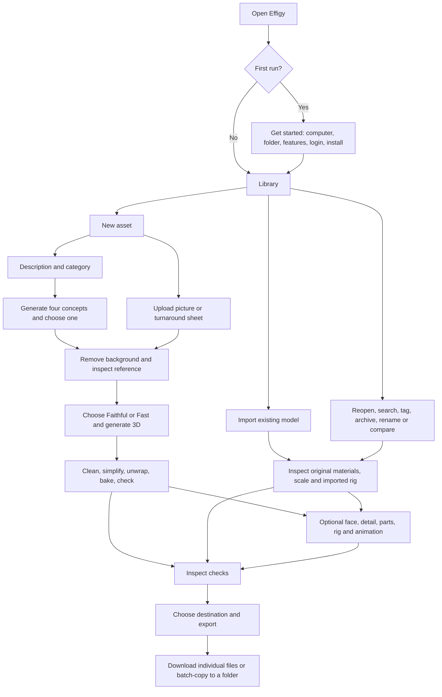

# Current workflow and interface map

Baseline: `06be15b`, reviewed 2026-10-12. This describes current behavior, not the October 4 proposal. Source locations refer to this baseline. Rendered checks and observations will be linked in FINDINGS.md.

## Product model

Effigy turns a description or reference picture into a 3D asset, or imports an existing model. Users inspect and improve immutable versions, optionally make characters move, and export for their destination. A person should understand the next useful action without learning version-folder names or Python step parameters.

## Destinations and persistent elements

| Surface | Goal and entry | Main controls | Existing states / behavior | Source |
|---|---|---|---|---|
| Header | Move among tasks | Library, New asset, Import, Setup; result notification; disk warning; GPU status | Current destination marked; hash URLs support Back and direct asset/version links | `ui/src/main.tsx:432` |
| Library | Find or reopen work | Search; sort; All/owner/test/restricted/imported/archive filters; tag filter; Select; New asset | Loading, first-run invitation, empty library, no matches, thumbnail cards; card actions Rename/Tags/Archive/Delete | `ui/src/main.tsx:577` |
| New asset | Start with description or image | Mode buttons; optional name; description; category cards; Generate 4 concepts; image chooser/drop; turnaround layout; Remove background | Missing-model warning and Setup link; file validation/preview; draft survives Setup navigation; submission lock | `ui/src/main.tsx:930` |
| Import | Bring an existing model | Optional name; file/ZIP drop; ignore rig checkbox; Import | Explains companion files and supported rigs; file-size/type errors; upload failure can reuse created asset | `ui/src/Import.tsx:16` |
| Workspace | Inspect selected version and choose next action | Asset name/Rename, checkpoint label/number, Licences, History; 14 stage buttons; preview; right action panel | Loading/not-found/empty; immutable versions; result selection; active job panel; branch-aware stages | `ui/src/main.tsx:1136` |
| Setup | Install or repair capabilities, manage storage and integrations | Capability cards; guided setup; model folder; cleanup; Blender check; agent config; credits; advanced model/licence table | Installed/checking/queued/installing/repair/gated/failure statuses | `ui/src/main.tsx:4618` |
| Get started | Initial installation | Five numbered sections: computer, folder, feature preset, Hugging Face, install; Skip for now | Hardware readings, disk-capacity warning, login/licence instructions, grouped install progress | `ui/src/main.tsx:4392` |
| Activity footer | Follow operations across pages | Jobs disclosure; per-job details/logs; Cancel | Queued/running/done/failed/cancelled; chain step count; GPU status also appears in header | `ui/src/main.tsx:4862` |

## Workspace controls

| Area | Current elements | Interaction and consequence |
|---|---|---|
| Stage row | Reference → Generate → Clean → Simplify → Unwrap → Bake → Face → Detail → Parts → Rig → Skin → Animate → Check → Export | Existing checkpoints open on the current branch. Some optional stages without a checkpoint scroll to their tool. Other future stages are disabled. Optional labels and hints are present. |
| Preview toolbar | Inspect material channel; Wireframe; Frame; camera directions; Axes; part coloring; animation/skeleton/weight controls when applicable | Inspect and camera operations affect preview. Canvas advertises orbit/zoom/pan instructions. |
| Reference | Source thumbnail; expand/collapse; Original/Cut-out switch | Compare image preparation and inspect model reference. |
| History drawer | Starred-only filter; folded intermediate steps; checkpoint pick; star; compare; label; delete branch | Close and Escape return focus to History when handled inside drawer. Delete confirms and moves files to trash recoverable by hand. |
| Compare | Two linked views; side labels; swap; close; metric comparison including check summary | Preview uses source mesh of report/export rather than collision export. |
| Licences | Version component names, terms and required credit text; imported-file note | Expands an inline panel above workspace body. |
| Next-step panel | Version-specific action forms; optional tools; Blender disclosure; advanced runner | Independently scrolls on desktop. Job state appears before the action forms. |

## Goal-by-goal paths

| ID | User goal | Current path and main action | Specialist or alternate path |
|---|---|---|---|
| W01 | Set up the machine | Get started → inspect computer → folder → feature preset → login/access → Install → Make your first asset | Setup installs/repairs individual capabilities, moves models and cleans storage. |
| W02 | Make a prop from words | New asset → From a description → name/description/category → Generate 4 concepts → choose image → Use this image → review cut-out → Generate 3D | Generate 4 more; edit description; advanced seed; choose generator/background. |
| W03 | Make a model from a picture | New asset → From an image → choose/drop file → Remove background → inspect Original/Cut-out → Generate 3D | Equal-width turnaround sheet with declared views; Faithful uses multiple views. |
| W04 | Import a model | Import → file or ZIP → Import → review What came in → Check model/export | Ignore skeleton/animations; unit correction; reimport as still; simplify an explicitly untextured copy. |
| W05 | Prepare generated geometry | Generated checkpoint → topology/budget/slit closure/texture size/height/alignment → Prepare model → clean/simplify/unwrap/bake/check | Intermediate checkpoints expose Run this step again and Continue preparation. |
| W06 | Improve texture or parts | Textured checkpoint → Face from image, Texture detail, Parts | Face region/strength; detail description/strength/shadow removal; render views/click part/name/rename; split for print. |
| W07 | Rig a character | Prepared model → template → Fit a skeleton → review placement → Skin it → inspect QA | Edit skeleton/markers; symmetry, x-ray, undo/redo; rigid parts attached to selected bone; creature direction correction. |
| W08 | Add animation | Skinned model → ready-made clip list → Add N animations → choose/play clip | Text prompt → Generate motion → Put this motion on the model; upload/trim video → motion → retarget. |
| W09 | Correct an animation | Animated checkpoint → Edit animation → clip/bone selection → keys/tools/foot locks/IK/trim/speed/ground → Save as a new version | Duplicate/delete copy, undo/redo, curve editor, reset to base, Close. |
| W10 | Check and export one asset | Check model → inspect pass/warning/fail checklist → destination → LOD/collision settings → Export → download files | Export without check or despite failures; choose another destination after export. |
| W11 | Export several assets | Library → Select → choose cards → Export selected → destination/folder → batch export/copy | Uses newest starred prepared checkpoint, otherwise newest prepared checkpoint; existing identical exports may be reused; skipped results are listed. |
| W12 | Return to earlier work | Library search/filter/sort → open asset → History → choose/star/label/compare checkpoint | Archive/unarchive; rename; tags; confirm deletion of asset or derived branch. |
| W13 | Edit in Blender | Workspace → Edit in Blender → open checkpoint → external editing → Pull changes | Requires addon connection; pulled mesh becomes a new checkpoint. |
| W14 | Recover from failure | Job/error details → correct input or setup → rerun/continue from immutable checkpoint | Result notification after navigation; reconnect refresh; cancel; failed-save animation state retention reproduced in this review; reconnect recovery covered by passing existing tests. |

## Review coverage

Source traced: routing/selection, library, creation, import, stage/lineage rules, generation/preparation/export, history/compare, setup/welcome, rig and clip entry points, animation save/close and timeline sizing. Rendered evidence and remaining limits are recorded in [FINDINGS.md](FINDINGS.md) and the [validation record](evidence/VALIDATION.md). W06–W09 contain advanced 3D editing paths whose model quality and physical output require specialist user testing; their interface clarity was reviewed through source, representative captures and the existing browser suite.
